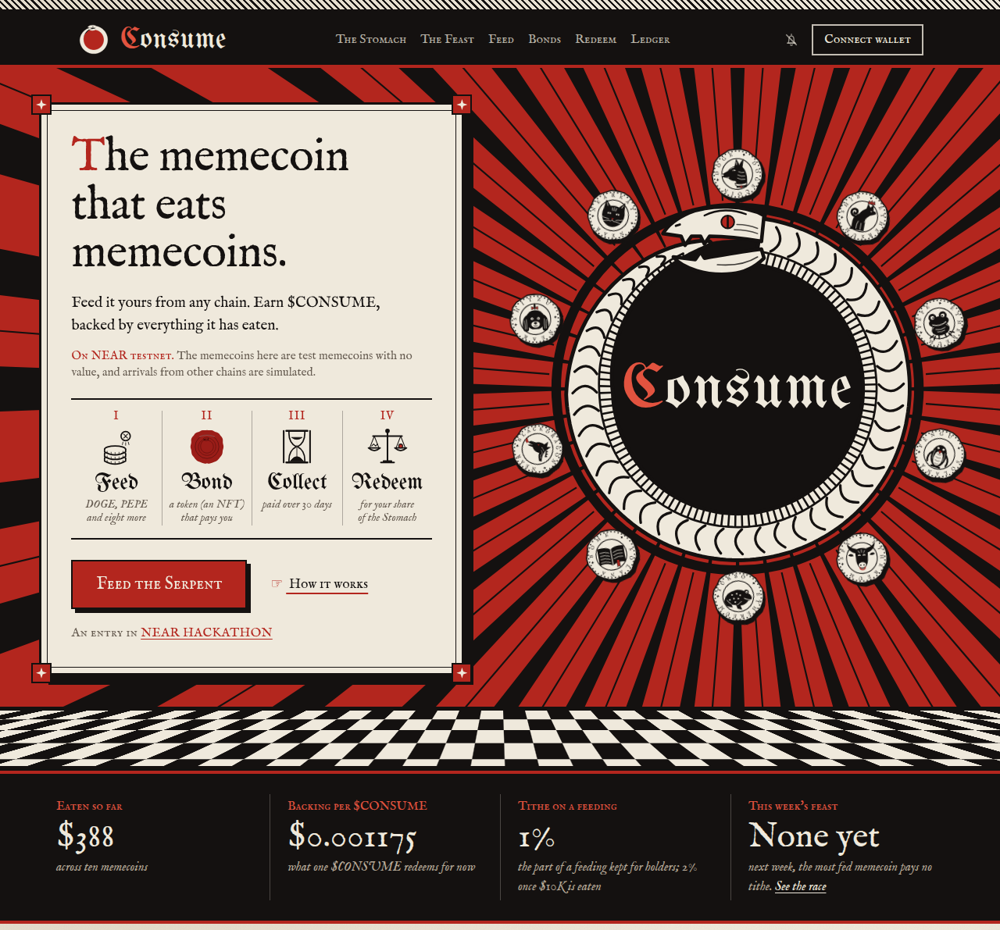
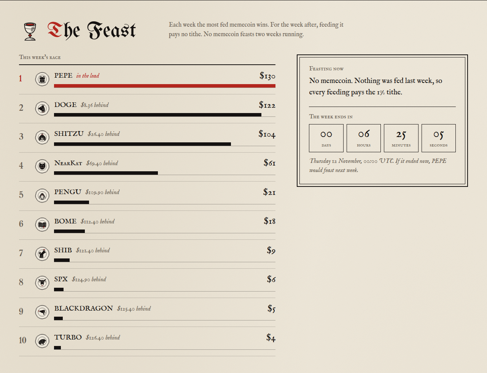
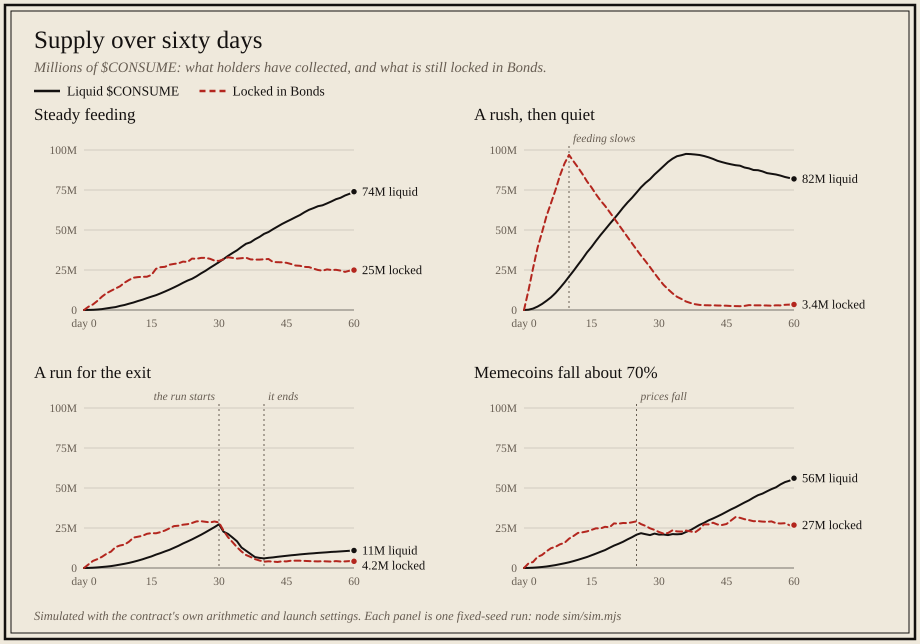
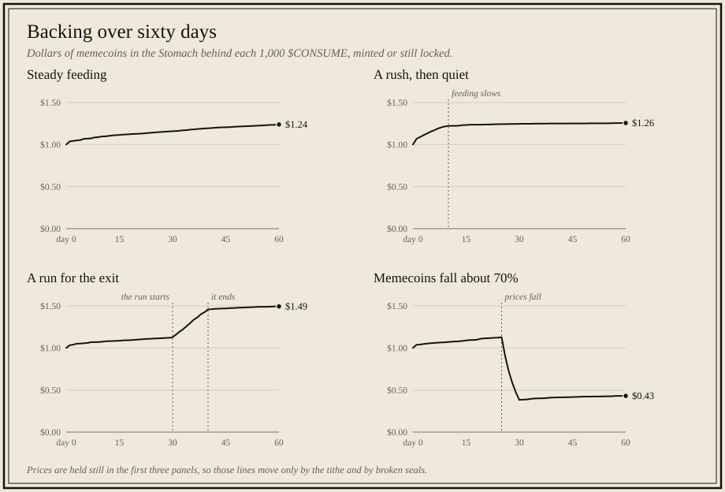

# CONSUME

**A memecoin that eats other memecoins.** Built for NEAR HACKATHON and entered on 2026-11-11 in the **Memecoins With Mechanics**, **NFTs That Do Something** and **Open Innovation** tracks.

[Live demo](https://consume.cash) · [Demo film, two minutes](https://x.com/EthBoi_/status/2120534208674447732) · [Try it](#try-it-in-two-minutes) · [Reproduce the checks](#reproduce-the-checks) · [Seen on testnet](#seen-on-testnet) · [CI](https://github.com/ethboi/consume/actions)

Feed it a memecoin from another chain or from NEAR (DOGE, PEPE, SHIB and seven more). The memecoin goes into its Stomach, where nothing takes it out except burning $CONSUME, and you are paid in $CONSUME through a **Bond**, an NFT that releases your $CONSUME over 30 days. Every $CONSUME can later be burned (**Redeem**) for its share of everything in its Stomach. So $CONSUME is a memecoin backed by a growing basket of other memecoins.

The memecoins track's own example prompt asks for five things. Each is here, and each has a section further down:

| The track's prompt asks for | In CONSUME | Detail |
| --- | --- | --- |
| A NEP-141 token with the mechanic in the contract, not in a backend that can be switched off | The whole mechanic is one NEAR contract (`contracts/consume`). $CONSUME is NEP-141 with no premine: `new` mints nothing. It is minted only when a Bond pays out (`claim`, `exit`) and burned only by `redeem`, for a share of every memecoin in the Stomach. The site keeps no database. The one piece off the chain is the price feed, described under this table. | [The mechanic, and where it lives](#the-mechanic-and-where-it-lives) |
| Parameters set at launch and readable by anyone, with no admin key that can change them | The memecoin list, caps, rates and periods are arguments to `new`, read back by `get_config` and `get_tribes`, and no method changes them. The contract account's only key was deleted on 2026-11-11 ([transaction](https://explorer.testnet.near.org/transactions/8LQwF4z3mxMiYo5uCcKwz5Q9vsfyiVGxFGhhi8WbsKN)), so the code cannot be replaced either. One role remains, the guardian, with exactly three methods: `set_tribe_open` (close a listed memecoin to new feedings, or reopen it), `set_price_feeder` (replace the Assayer) and `set_guardian` (pass the role on, or renounce it). It cannot mint, withdraw, list a memecoin or change a number. | [Every method that changes state](#every-method-that-changes-state), [Trust assumptions](#trust-assumptions) |
| Sybil limits, written plainly | Nothing in the contract counts accounts: no airdrop, no reward per account, no referral. Caps are per memecoin and shared by every account, and the Feast is won by dollars. The limit is that one account can use up a memecoin's whole day. | [Sybil limits, plainly](#sybil-limits-plainly) |
| A page with a log of every mint and burn | The Ledger on [consume.cash](https://consume.cash/#ledger), also JSON at `/api/ledger`. It is read from the events the contract emits, added up, and compared with the contract's own totals. It depends on a public indexer to find the transactions. | [Every mint and burn, logged](#every-mint-and-burn-logged) |
| 60 days of community behaviour simulated, with supply over time under a few scenarios | `node sim/sim.mjs`: four scenarios on a port of the contract's arithmetic, with the backing checked after every action. CI fails if the published table or charts differ from the run. | [Sixty days, simulated](#sixty-days-simulated) |

**The limit, stated first: one account posts the prices.** A feeding is valued in USD, and the prices come from the Assayer, an account that reads NEAR Intents 1Click quotes and posts them with `set_prices`. The contract takes what that account posts and puts no bound on how far a price may move. The Assayer cannot take anything out of the Stomach, and redeeming needs no price, but a wrong price misprices feedings, and a dishonest Assayer could let one feeding claim most of the Stomach. On testnet the Assayer has had its own account since 2026-11-11, `assayer.consumecash.testnet`, whose only key can call `set_prices` and nothing else ([transaction](https://explorer.testnet.near.org/transactions/G1LAQEv9jzRMWFqL7BQzLHwv1bkm9JYF4uLBu9qEuZ31)). The guardian, which can replace it, has been a Sputnik DAO since 20:30 UTC that day, `consume-guardian.sputnikv2.testnet` ([handover](https://explorer.testnet.near.org/transactions/3PdUM8nJXgu2L4eb8fDMLyXSGjkuNtJ3LHSUroZqhpnC)). Its council is one account, the builder's, so one person still decides who posts prices, now by a public proposal and vote. The whole of it is under [Trust assumptions](#trust-assumptions).



## Try it in two minutes

[Step-by-step demo guide](https://consume.cash/demo) · [Source](https://github.com/ethboi/consume)

Allow about two minutes **after funding a NEAR testnet wallet**. All memecoins here are free test tokens; cross-chain arrivals and withdrawals are simulated. A second existing testnet wallet you control lets you try the NFT ownership handoff.

1. **Connect and fund.** Open the site, connect a testnet wallet, and use [near-faucet.io](https://near-faucet.io/) if needed. Have at least **0.2 test NEAR** for a first feeding’s storage and gas. Pick PEPE and press **Bring test PEPE from Ethereum**. Expect a test Intents balance; this is not a real bridge deposit.
2. **Feed $10.** Read the quote, tithe and Bond amount, then press **Feed the Serpent** and approve. Expect a numbered Bond and a transaction link. At unchanged prices a 1% tithe leaves $9.90 of claim value; the actual $CONSUME count depends on current backing.
3. **Pass the Bond.** In Bonds, press **Send this Bond**, enter your second testnet account, review and confirm. Expect the same NFT and schedule in the recipient’s wallet. The **0.01024 NEAR** reserve comes from the sender’s storage credit; the form adds **0.1 NEAR** credit if needed and discloses it before signing. This sends the NFT without collecting payment. A sale through an approved account is tested on a local sandbox ([how control passes](#how-control-passes-on-transfer-and-what-stops-the-seller)); no marketplace has listed a Bond on testnet.
4. **Collect or exit.** Switch to the recipient. Vesting is continuous over 30 days, so a brief wait makes a small amount collectible. Collect pays the current holder; its first $CONSUME registration is paid separately. To finish immediately, **Break the seal early** shows what you receive and the half of still-locked tokens you forfeit before confirmation.
5. **Redeem.** Burn some collected $CONSUME for the displayed basket. Expect test memecoins in your Intents balance and a burn in the Ledger. Redemption may add **0.1 NEAR** storage credit if low. Spent storage is not refundable; unused credit can be withdrawn from the feeding panel.

The guide and [demo notes](docs/DEMO.md) distinguish public testnet evidence from local browser tests. A two-minute demo film is in the [demo post on X](https://x.com/EthBoi_/status/2120534208674447732). Independent-user feedback is not yet available.

## Why participate?

The product hypothesis is a shared memecoin basket with a weekly contest between communities. If DOGE wins the Feast, next week a $10 DOGE feeding earns a claim for the full $10, while a rival paying a 1% tithe earns a $9.90 claim, at unchanged prices. No memecoin feasts two weeks running, so the crown moves every week: supporters feed to win it, sit a week out, then try to win it back. Bonds let the resulting vesting claim change hands without resetting the schedule.

The trade-off is a tithe and a 30-day release period. Keeping the original coins avoids both. Early exit forfeits half of what is still locked; NFT transfer does not promise liquidity or a buyer. Later tithes and forfeitures can increase backing per claim, but memecoin prices can fall. This is a community-game hypothesis, not a guaranteed return or evidence of product-market fit. Current bot activity is builder-operated. [The demo notes](docs/DEMO.md#independent-feedback) give a short protocol for collecting real feedback without counting those bots as users.

## What the track asks for, and where the code answers

Memecoins With Mechanics asks for a memecoin where the meme does something, judged on the mechanic and not the chart. The track’s examples and optional project suggestions are mapped below; they are not an additional mandatory checklist. Code claims can be inspected in the named files, while runtime claims need the tests and deployment evidence. Contract paths are under `contracts/consume/src/`.

| The track names | In CONSUME | Read |
| --- | --- | --- |
| Supply that reacts to the community | No premine, no team allocation, no emission schedule: `new` mints nothing. A feeding writes $CONSUME into a Bond and mints none. $CONSUME is minted in one place, `mint_consume`, which only `claim` (collect from a Bond) and `exit` (break its seal) call, and burned by `redeem`. The one other burn is the NEP-141 library's own edge case: a refund owed to a sender who sent their whole balance and unregistered before the transfer resolved (`standards.rs` `ft_resolve_transfer`), which only raises the backing. `storage_unregister` refuses to force out an account that still holds $CONSUME. What a broken seal forfeits is never minted. So supply rises only as fed memecoins vest, and falls with every redemption. | `lib.rs` `new`; `vest.rs` `mint_consume`, `claim`, `exit`; `redeem.rs` `redeem`; `standards.rs` `ft_resolve_transfer`, `storage_unregister` |
| Treasuries with rules | The Stomach: every memecoin fed, held by the contract. One rule lets a memecoin out: burn $CONSUME and receive that share of each memecoin held, counted against all $CONSUME including what is still locked in Bonds. No method lets the guardian, the Assayer or the deployer take anything out. The full list of methods is below. | `redeem.rs` `quote`, `redeem`, `start_withdrawals`, `on_withdraw` |
| Onchain rituals and challenges | **The Feast:** each week the memecoin fed most wins, and feeding it pays no tithe the week after. No memecoin feasts two weeks running. **Famine:** the tithe on every feeding rises by 1% with each $10,000 eaten, to 10% at most. **Break the seal:** leave a Bond early and half of what is still locked is given up to those who stay. | `lib.rs` `heaviest_tribe`; `meal.rs` `plan_meal`; `math.rs` `tithe_at`; `vest.rs` `exit` |
| NEP-141 and token mechanics (the track's hints) | $CONSUME is a NEP-141 token with NEP-145 storage and NEP-148 metadata. Every mint and burn emits the standard NEP-141 event (`FtMint` and `FtBurn` from near-contract-standards, logged as `ft_mint` and `ft_burn`), so wallets and indexers follow the supply without knowing CONSUME. A feeding arrives one of two ways, fixed for each memecoin at launch: `mt_transfer_call` on the Intents contract, received by `mt_on_transfer` (all ten launched memecoins are set this way, see `scripts/launch-args.mjs`), or `ft_transfer_call` on a plain NEP-141 memecoin, received by `ft_on_transfer` (the path the first sandbox test uses). | `standards.rs`; `vest.rs` `mint_consume`; `redeem.rs` `redeem`; `intents.rs` `mt_on_transfer`; `meal.rs` `ft_on_transfer` |
| Beyond the hints | Bonds are NEP-171 NFTs (with NEP-177, NEP-178 and NEP-181) that carry a vesting position, each minted with the standard NEP-171 event (`NftMint`, logged as `nft_mint`). Memecoins from other chains arrive through NEAR Intents, where CONSUME is a NEP-245 receiver. | `standards.rs`; `meal.rs` `eat`; `intents.rs` `mt_on_transfer` |

### The second track: NFTs That Do Something

That track asks for NFTs as accounts, ownership with behavior, and names dynamic NFTs and NEP-171. A Bond is the only way $CONSUME is paid out, so the NFT is the position itself and not a picture of it.

| The track names | In a Bond | Read |
| --- | --- | --- |
| NFTs as accounts | Partly. A Bond is not a NEAR account: it has no keys, signs nothing and cannot hold other assets. What it takes from the idea is that the money belongs to the token and not to a wallet. Each Bond carries $CONSUME that has not been minted yet and releases it over 30 days, and `claim` and `exit` pay whoever holds the Bond when they are called. | `lib.rs` `Vest`; `vest.rs` `claim`, `exit`, `get_vest`; test `claim_releases_linearly_to_the_current_holder` |
| Ownership with behavior | The holder can collect what has been released, or break the seal and give up half of what is still locked. A transfer or sale carries the lock and the schedule with it. A new holder pays for their own $CONSUME registration. | `vest.rs`; tests `exit_forfeits_half_of_the_locked_part`, `a_bond_received_later_pays_its_own_registration` |
| Dynamic NFTs | The card is drawn from the Bond's state each time it is asked for: the memecoin fed, the amount, the days released, the seal intact or broken. New metadata uses immutable inline SVG in `media` with its SHA-256 `media_hash`; `extra.dynamic_media` points to the changing card. The site renders the live state. | `web/src/lib/bond-svg.ts`, `web/src/app/bond/`; `meal.rs` `eat` (the metadata) |
| NEP-171 | NEP-171 with NEP-177 metadata, NEP-178 approvals and NEP-181 enumeration, and the standard mint event. | `standards.rs`; `meal.rs` `eat` |
| Transfers, threat by threat | A Bond inside an unresolved `nft_transfer_call` cannot be collected from, broken or sent again, so a receiving contract cannot drain it and hand it back. A sale through an approval is walked on a sandbox, and the table below takes the seller's moves one at a time. | `vest.rs`, `standards.rs`; tests `bond_in_flight_cannot_be_claimed`, `bond_in_flight_cannot_have_its_seal_broken`, `a_bond_in_flight_cannot_start_another_transfer_call`; sandbox `sale.rs` |

### How control passes on transfer, and what stops the seller

A Bond has one holder: the owner NEP-171 records for its token id. `claim` and `exit` read that record when they are called and mint to that account in the same call (`vest.rs`). There is no separate beneficiary and nothing is queued for a past holder, so a transfer hands over the whole position at once: what has been released and not collected, what is still locked, and the right to break the seal.

| The seller tries to | What the contract does | Tested by |
| --- | --- | --- |
| Collect or break the seal after the sale | Refused: "Only the Bond holder can claim", "Only the Bond holder can exit". The new holder is the one paid. | sandbox `sale.rs`; `claim_releases_linearly_to_the_current_holder` (the new holder is paid) |
| Collect just before the sale goes through, so the buyer gets less than was listed | The collection is the seller's to make, but `claim` and `exit` remove every approval on the Bond and refund the storage paid for them. The listing is void and the marketplace's transfer is refused ("Sender not approved"). A new listing gets a new, higher approval id, so an old offer cannot be replayed. A refused claim leaves the approvals as they were. | sandbox `sale.rs`; `claims_and_exits_invalidate_all_approvals_without_reusing_ids`, `a_market_cannot_transfer_a_bond_after_its_owner_claims`, `a_refused_claim_preserves_approvals` |
| Take the Bond back, or have the marketplace move it again | Refused: a transfer clears the Bond's approvals (NEP-178), and the seller is no longer the holder. | sandbox `sale.rs` |
| Send it to a contract that collects and hands it back | A Bond inside an unresolved `nft_transfer_call` cannot be collected from, broken or sent again. | `bond_in_flight_cannot_be_claimed`, `bond_in_flight_cannot_have_its_seal_broken`, `a_bond_in_flight_cannot_start_another_transfer_call`, `a_bond_in_flight_cannot_be_transferred_directly` |

`contracts/integration-tests/tests/sale.rs` walks a sale on a local NEAR node: the seller lists Bond 1 with `nft_approve`, collects (which voids that listing), lists again, the approved account sends the Bond to the buyer with `nft_transfer`, the seller's `claim`, `exit` and `nft_transfer` are refused, and the buyer collects and then breaks the seal. At the end the seller's $CONSUME, the buyer's and the forfeit add up to exactly what the Bond was minted with. On 2026-11-11 it also passed against the code downloaded from the live account (`CONSUME_WASM`, see the file's header; sha256 `71316ae9a7f7ebd69ca796bde5f390f95331bf2cc3a29490834fa95cdc3093a3`, the same as the local build).

What this does not cover:

- **Price and payment.** The contract takes no part in them. Escrow and settlement are the marketplace's.
- **Value at the moment of sale.** A Bond's $CONSUME only leaves it through `claim` and `exit`, and both void the listing, but what a $CONSUME is worth moves with the Stomach. A buyer should read `get_vest` when buying.
- **Storage.** The account that calls the transfer pays a 0.01024 NEAR reserve from its own storage credit (`standards.rs` `reserve_bond_transfer_storage`), so a marketplace's account needs credit first; anyone can add it with `add_meal_credit({"account_id": ...})`. Without it the transfer is refused and the listing stands. A buyer who has never held $CONSUME pays for their registration from their own credit on first collecting (`a_bond_received_later_pays_its_own_registration`).
- **A real marketplace.** In the test a plain account stands in for one and calls `nft_transfer` with the approval id. No marketplace contract has listed a Bond on testnet, and `nft_approve` with a `msg` (the `nft_on_approve` callback) is not exercised.

### The third track: Open Innovation

Open Innovation asks for something not seen before: new ways for money, intelligence and ownership to work together, with chain abstraction among its hints. CONSUME is entered there because it does not sit inside either of the other two tracks. It is a memecoin, an NFT position and a cross-chain basket at once, and each part needs the others.

- **Money.** A token with no supply of its own. Every $CONSUME exists because someone fed another community's memecoin to the contract, and it can always be burned for its share of what was fed. Redeeming needs no price, no pool and no buyer (`redeem.rs` `quote`, `redeem`).
- **Ownership.** The claim on that money is not a balance. It is a Bond, an NFT that can be sent or sold while it is still paying out, whose listing is void the moment its holder takes value out of it ([how control passes](#how-control-passes-on-transfer-and-what-stops-the-seller)).
- **Intelligence.** An agent can do what a person can. The MCP server (`web/src/lib/mcp.ts`, 14 tools) reads the Stomach, the Feast and the Ledger and returns unsigned calls for a feeding, a collection, a broken seal or a redemption. Eight bot accounts feed and collect on testnet with the same tools ([For agents](#for-agents)).
- **Chain abstraction.** The ten memecoins live on Dogecoin, Ethereum, Solana and NEAR. NEAR Intents puts them in one balance, so one contract holds the basket and pays redemptions back into it (`intents.rs`). On testnet that leg is a stand-in contract with the same calls, because NEAR Intents has no testnet.

The parts have precedents: baskets redeemed in kind, bonds that vest, NFTs that carry a position. What we have not seen is them joined: a memecoin minted only through transferable vesting NFTs, backed only by other memecoins, fed across chains, with a weekly contest between the communities it eats.

**The case against it,** since the track's example prompt asks for one before building:

1. *A basket of memecoins is a basket of things that fall together.* True, and not answered. The backing is a share of ten memecoins, not a price in dollars. The simulation's fourth scenario shows it: prices down about 70%, backing down to $0.42 from $1.00.
2. *Nobody needs it: holding the memecoins avoids the tithe and the 30 days.* Partly answered. What a feeder gets that a holder does not is a share of later tithes and broken seals, and the Feast. Whether anyone wants that is not shown: every feeding so far is the builder's own.
3. *It needs a trusted price.* Answered only in part. Redemption needs none. Feeding does, and that trust is one account ([Trust assumptions](#trust-assumptions)).
4. *Late feeders pay early ones, which is how a Ponzi works.* Answered by the arithmetic. A feeding earns at the backing, so a later feeder is not diluted and an exit is paid from the Stomach, never from a later deposit. The only transfers are the tithe and broken seals, both stated before signing (`math.rs` `consume_at_floor`; the simulation's run for the exit).

**How it fails,** in the track prompt's terms:

| Failure | What happens |
| --- | --- |
| The Assayer stops, or its key is lost | Prices go stale after 15 minutes and every feeding is refused. Collecting, breaking a seal and redeeming go on. The guardian can appoint a new Assayer; with the guardian renounced, feedings would stop for good. On testnet the Assayer's account has no full-access key, so a lost key cannot be replaced on the account itself: a new Assayer named by the guardian is the only way back. |
| The Assayer turns hostile | It can misprice feedings, up to letting one feeding claim most of the Stomach. It cannot withdraw anything itself. The guardian can replace it. |
| The guardian turns hostile | It can appoint a hostile Assayer, with the damage above, or close memecoins to feeding. It cannot change a parameter, mint or withdraw. |
| A fault is found in the contract | It stays. The contract account has no key, so nobody can replace the code. |
| NEAR Intents or a listed token contract fails | Redemptions of that memecoin fail and are kept as owed (`redeem.rs` `on_withdraw`); the rest are paid. |

### Every method that changes state

This is the whole list, so two things can be checked by reading it: no method changes a rule, and no method moves a memecoin out of the Stomach except the payout of a redemption. (The guardian can seal a memecoin against new feedings and replace the Assayer; see [Trust assumptions](#trust-assumptions).) `grep -n "pub fn" contracts/consume/src/{lib,meal,vest,redeem,intents}.rs` shows these and the views (`get_*`, `quote_*`), and nothing else. (`math.rs` holds plain functions, not methods, and `ft_on_transfer` and the standards are trait methods.)

| Who may call | Methods | File |
| --- | --- | --- |
| Once, at launch | `new` | `lib.rs` |
| The Assayer (price feeder) | `set_prices` | `lib.rs` |
| The guardian | `set_tribe_open`, `set_price_feeder`, `set_guardian` | `lib.rs` |
| Any account | `add_meal_credit`, `withdraw_meal_credit` (storage credit) and, on what it holds itself, `claim`, `exit`, `redeem`, `withdraw_owed` | `lib.rs`, `vest.rs`, `redeem.rs` |
| A feeding: accepted only from a listed memecoin's token contract, or from the Intents contract | `ft_on_transfer`, `mt_on_transfer` | `meal.rs`, `intents.rs` |
| The contract itself | `on_withdraw` (the callback after a payout) | `redeem.rs` |
| Anyone, by the standards | NEP-141, NEP-145, NEP-171 and NEP-178 methods (`ft_transfer`, `storage_deposit`, `nft_transfer`, `nft_approve` and the rest) | `standards.rs` |

This contract has no administrator withdrawal, upgrade or migration method, no pause of redemptions, and no setter for the memecoin list, caps, rates or periods. A full-access key on the contract account could replace the code outside these methods; on testnet that key has been deleted (see the trust assumptions below).

### The story's words, and the names in the code

The site and this README use the story's words. The contract keeps plain or older names, so search for the right-hand column.

| In this README | In the code |
| --- | --- |
| Bond | `Vest`, `vests`, `get_vest` (the NFT's token id is the vest id) |
| Collect | `claim` |
| Break the seal | `exit`; the half given up is `exit_haircut_bps`, counted in `total_forfeited` |
| A listed memecoin | `Tribe`, `tribes`, `get_tribes` |
| The Stomach | `Tribe.stomach` (the amount held of each memecoin), valued by `stomach_usd` |
| A feeding | a meal: `plan_meal`, `eat`, `quote_meal`, event `meal` |
| The backing | the floor: `consume_at_floor`, with `claims` and `stomach_usd` |
| Tithe and famine | `tithe_at`, `after_tithe`, `tithe_step_bps`, `max_tithe_bps`, `famine_usd` |
| The Feast, a week | `feast_for`, `heaviest_tribe`, `epoch_fed`, `epoch_ns` |
| The Assayer | `price_feeder_id`, `set_prices` |
| Storage credit | `meal_credit` |

## The mechanic, and where it lives

Each rule is contract code under `contracts/consume/src/`, and each test named in the last column is a function of that name in `contracts/consume/src/tests.rs`. Where the column says sandbox, the file is under `contracts/integration-tests/tests/`.

| Rule | What the contract does | Code | Test |
| --- | --- | --- | --- |
| **Feed** | Takes a listed memecoin, values it at the posted price, keeps it in the Stomach, refunds anything over the cap, mints a Bond. | `meal.rs` `plan_meal`, `eat` | `a_feeding_mints_a_bond`, `over_the_meal_cap_is_refunded`, `daily_cap_holds`, `stale_price_refused`, `a_round_must_price_every_open_memecoin`, `a_zero_price_is_refused`, `unknown_token_refused`, `feeding_without_storage_credit_is_refused` |
| **Earned at the backing** | A feeding earns `fed value × $CONSUME with a claim ÷ Stomach value`, so $100 fed buys a claim on $100 of the Stomach, whenever you arrive. The first feeding sets the scale at 1000 $CONSUME per dollar. A feeding can never lower the backing per $CONSUME. | `math.rs` `consume_at_floor`, `lib.rs` `stomach_usd_for_minting`, `claims` | `minting_at_the_floor_math`, `the_stomach_is_rounded_up_when_a_feeding_is_priced`, `a_feeding_never_lowers_the_floor`, `a_late_feeder_gets_what_they_fed_less_the_tithe`, `a_feeding_that_would_mint_nothing_is_refused` |
| **Famine** | Each feeding pays a tithe: a part of it that earns no $CONSUME and so belongs to everyone already holding. It is 1% at the start and grows by 1% with every $10,000 eaten, to 10% at most. A feeding that crosses a famine pays each tithe on its part on each side. | `math.rs` `tithe_at`, `after_tithe` | `famine_grows_the_tithe_to_its_cap` |
| **Feast** | The memecoin fed most (by USD) in a week pays no tithe the following week. None feasts two weeks running: if the one feasting is fed the most again, the Feast passes to the most fed of the others, or to none if no other was fed. Each week's Feast is written down at that week's first feeding. | `lib.rs` `feast_for`, `heaviest_tribe`, `record_feast`, `meal.rs` `plan_meal` | `the_feast_waives_the_tithe_next_epoch`, `no_memecoin_feasts_two_weeks_running`, `the_crown_changes_hands_every_week_when_one_memecoin_is_always_fed_most`, `a_feast_fed_alone_is_followed_by_a_week_with_no_feast`, `a_week_with_no_feedings_ends_the_run`, `a_tie_goes_to_the_first_listed_that_did_not_just_feast` (`feast_tests.rs`), and four weeks on a sandbox in `integration-tests/tests/feast.rs` |
| **Bond** | An NFT that releases its $CONSUME linearly over 30 days to whoever holds it. | `vest.rs` `claim` | `claim_releases_linearly_to_the_current_holder` |
| **Break the seal** | Leave early with what has been released plus half of the rest. The other half is never minted. | `vest.rs` `exit` | `exit_forfeits_half_of_the_locked_part`, `a_broken_seal_raises_the_floor`, `bond_in_flight_cannot_have_its_seal_broken` |
| **Redeem** | Burn $CONSUME for a pro-rata share of every memecoin in the Stomach, counted against all $CONSUME including what is still locked in Bonds. | `redeem.rs` `redeem` | `redeem_pays_a_fair_share_counting_unvested`, `a_redemption_that_would_pay_nothing_is_refused`, `a_failed_payout_stays_owed_and_a_paid_one_is_cleared` |
| **From any chain** | Memecoins arrive from NEAR Intents balances and redemptions are paid back into them. | `intents.rs` `mt_on_transfer`, `redeem.rs` `start_withdrawals` | `intents_feeding_mints_a_bond`, `intents_feeding_refunds_over_the_cap`, `intents_feeding_reads_the_msg`, `intents_feeding_from_anyone_else_is_refused`, `intents_feeding_takes_one_memecoin_at_a_time`, `intents_feeding_of_someone_elses_balance_is_refused`, sandbox `intents.rs` |
| **Fixed at launch** | The memecoin list, caps, starting rate, tithe schedule, vesting period, forfeit, week length, Intents contract and image base are arguments to `new`. No method changes them. | `lib.rs` `new` | `the_launch_list_is_what_new_was_given`, `launch_refuses_a_memecoin_listed_twice`, `launch_refuses_an_intents_memecoin_without_the_intents_contract`, sandbox `flow.rs` |
| **Guardian, not owner** | One role with two switches: seal or unseal a listed memecoin, replace the price feeder. It can be renounced. It cannot list a memecoin, change a number, mint or withdraw. | `lib.rs` `set_tribe_open`, `set_price_feeder`, `set_guardian` | `the_guardian_can_seal_a_memecoin`, `nobody_else_can_seal_a_memecoin`, `a_sealed_memecoin_stays_redeemable_and_can_be_unsealed`, `a_replaced_price_feeder_can_no_longer_post_prices`, `a_renounced_guardian_has_no_power_left` |

## Reproduce the checks

Every claim below can be checked from a clean clone. Prerequisites are under [Try it](#try-it).

| # | Run this, from the repository root | You should see |
| --- | --- | --- |
| 1 | `(cd contracts/consume && cargo test)` | `test result: ok. 71 passed; 0 failed` |
| 2 | `(cd contracts/mock-intents && cargo test)`; `(cd contracts/mock-meme && cargo test)` | mock-intents: **7 passed**; mock-meme: **3 passed** |
| 3 | `for c in consume mock-meme mock-intents; do (cd contracts/$c && cargo near build non-reproducible-wasm); done` | three `.wasm` files under `contracts/target/near/` |
| 4 | `(cd contracts/integration-tests && cargo test --test flow)` | `test offering_claim_redeem ... ok`. On a real local NEAR node: feed, refund over the cap, Bond, collect, redeem with exact payouts, a failed payout kept as owed and paid on retry. It also asserts that `set_tribe`, `set_intents_id`, `set_media_base` and `set_owner` do not exist and that a second `new` is refused as already initialized. |
| 5 | `(cd contracts/integration-tests && cargo test --test intents)` | `test feed_and_redeem_through_intents ... ok`. Through the NEAR Intents stand-in: a simulated arrival from the home chain, a feeding by `mt_transfer_call`, the part over the cap refunded into the Intents balance, collect, a redemption paid by `mt_transfer`, and a simulated withdrawal. |
| 5b | `(cd contracts/integration-tests && cargo test --test feast)` | `test no_memecoin_feasts_two_weeks_running ... ok`. Four weeks on a local node with PEPE fed the most in each: the Feast is none, PEPE, DOGE, PEPE, checked in the quotes, on the Bonds and through `get_feast`. The second test in the file rehearses upgrading a contract launched on an older build; it does that only when `CONSUME_OLD_WASM` names such a build, and otherwise passes without running. |
| 5c | `(cd contracts/integration-tests && cargo test --test sale)` | `test an_approved_sale_passes_the_payout_to_the_buyer ... ok`. A Bond sold through an approval on a local node: listed with `nft_approve`, the listing voided by the seller's own collection, listed again, sent to the buyer by the approved account, the seller refused, the buyer paid. Set `CONSUME_WASM` to run it against another build, such as the code downloaded from the live account. |
| 5d | `(cd contracts/integration-tests && cargo test --test round)` | `test a_round_with_quotes_sets_the_same_prices_and_stores_nothing_else ... ok`. A price round sent the way the Assayer sends it, with its quotes as a second argument: the contract sets the same prices as a plain round and nothing else in its state changes. `CONSUME_WASM` works here too. |
| 6 | `(cd web && pnpm install && pnpm dev)`, then open `http://localhost:3000` | The site, with a note that it is showing sample figures. Buttons that need a contract are off. |
| 7 | `curl http://localhost:3000/api/routes` | JSON with ten routes. These are live mainnet NEAR Intents (1Click) dry quotes, not samples: for each memecoin, whether NEAR Intents will trade $100 of it into USDC right now and what comes out. The "From any chain" section of the site shows the same data. |
| 8 | open `http://localhost:3000/bond/209.svg` and `/bond/square/209.svg` | A Bond drawn as a tarot card from its state (amount fed, days released, seal intact or broken). |
| 9 | `node sim/sim.mjs` | The table in [Sixty days, simulated](#sixty-days-simulated), then `Wrote 4 CSV files and summary.md to sim/out/, and supply.svg and backing.svg to sim/charts/.` and `Wrote the same figures to web/src/lib/simulation.json for the site.` The run stops with an error if any feeding, broken seal or redemption lowers the backing. |
| 10 | `echo '{"jsonrpc":"2.0","id":1,"method":"tools/list"}' \| node agents/mcp.mjs` | One line of JSON naming the MCP server's 14 tools. |
| 11 | `node agents/bots.mjs herald` | A report read from the live testnet contract: the Stomach, the backing, the Feast race and anything that needs attention. It signs nothing. |
| 12 | `curl -s -X POST http://localhost:3000/api/mcp -H 'content-type: application/json' -d '{"jsonrpc":"2.0","id":1,"method":"tools/call","params":{"name":"feast_race","arguments":{}}}'` | The same server over HTTP, from the site started in step 6: this week's Feast standings on testnet. |
| 13 | `echo '{"jsonrpc":"2.0","id":1,"method":"tools/call","params":{"name":"ledger","arguments":{}}}' \| node agents/mcp.mjs` | The log of every feeding, mint and burn on the live testnet contract (within the limits given in that section), each with its transaction, and `listed_totals_match_contract: true` when aggregate totals agree; `history_completeness` remains `unknown`. `feedings` gives how many came from the builder's own accounts (`by_builder`) and how many from everyone else (`by_others`). See [Every mint and burn, logged](#every-mint-and-burn-logged). |
| 14 | `(cd web && pnpm install && pnpm exec playwright install chromium && node e2e/run.mjs sample)` | `21 passed`. The site, built with no contract set, driven in a real browser: every section adds up from its sample data, the quote follows the contract's rule, every button that would sign is off, the previews send nothing, the simulation's table matches `sim/out/summary.md` cell for cell, and nothing runs off the side of a phone. |
| 15 | `(cd web && node e2e/run.mjs chain)`, after steps 3 and 14 | `36 passed`. The whole product through the site itself: a local NEAR sandbox, the contract as built in step 3, the site built against it, and a browser with a test wallet. Connect, feed, a refused signature, the Bond and its picture, a feeding over the limit, Collect all, Break the seal, Redeem, an agent feeding with the calls the MCP server prepares, the Ledger, and a price round shown beside its quotes. Each step is checked on the page and against the contract's own views, and the run fails if the backing of a $CONSUME ever falls. What is a stand-in there is listed in [web/e2e/README.md](web/e2e/README.md). |
| 16 | `(cd web && node e2e/run.mjs live)` | `8 passed` while the public site and the Assayer are up. Read-only checks of [consume.cash](https://consume.cash): the page agrees with what the contract reports, prices are fresh, and the Ledger adds up. It connects no wallet and signs nothing. |

Step 4 downloads a NEAR sandbox node and builds OpenSSL on first run, which takes a few minutes. Step 6 needs network access for uncached dependencies. Page and card fonts are bundled from installed `@fontsource` packages; startup and build do not fetch Google Fonts. Steps 7, 11, 12, 13 and 16 need network access (NEAR Intents 1Click, a public testnet RPC and, for step 13, FastNEAR's public transactions API). Steps 9 to 11 and 13 need Node.js 22.18 or newer and nothing installed. Steps 14 to 16 run in Chromium, which the command in step 14 downloads (`E2E_CHANNEL=chrome` uses an installed Chrome instead); steps 14 and 15 stay on the local machine once that is done.

## Status

> **Status, 2026-11-11.** Live on NEAR testnet: contract [`consume.consumecash.testnet`](https://testnet.nearblocks.io/address/consume.consumecash.testnet), site at [consume.cash](https://consume.cash) (also [consume-ivory.vercel.app](https://consume-ivory.vercel.app) while the domain settles). Every action has been run there, and each transaction is linked under [Seen on testnet](#seen-on-testnet). Current checks passed 71 CONSUME, 7 mock-intents and 3 mock-meme unit tests, 30 web unit tests, the sandbox tests (five files) and 57 local browser tests (21 sample, 36 sandbox), plus 8 read-only live checks. The rule that no memecoin feasts two weeks running is live on testnet: the contract was upgraded in place on 2026-11-11 ([transaction](https://explorer.testnet.near.org/transactions/BPkQwiMUJmjb7VqY9LWLjS6JjtrnwNNYpbkQuob5J1ay)) with its state unchanged. The first Feast is crowned on 2026-11-12, so the first week in which the rule can change who feasts starts on 2026-11-19. A 60-day simulation (`sim/`) and an MCP server with four bots (`agents/`) are in the repository, and the MCP server answers at `https://consume.cash/api/mcp`. Since 2026-11-11 two of the bots, the feeder and the collector, run on testnet as eight subaccounts of the deployer's own account (`glutton.consumecash.testnet`, `doge-maxi.consumecash.testnet` and so on), so most new entries in the Ledger are theirs, not a visitor's. The Ledger counts the builder's accounts apart from everyone else's: as read on 2026-11-11 at 18:57 UTC, all 42 feedings came from the builder's own accounts and none from anyone else ([Every mint and burn, logged](#every-mint-and-burn-logged)). A two-minute demo film is in the [demo post on X](https://x.com/EthBoi_/status/2120534208674447732), posted 2026-11-11. After that upgrade the contract account's only full-access key was deleted ([transaction](https://explorer.testnet.near.org/transactions/8LQwF4z3mxMiYo5uCcKwz5Q9vsfyiVGxFGhhi8WbsKN)): the account holds no key, so its code can no longer be replaced, by the builder or anyone else. At 19:26 UTC the same day the Assayer moved to its own account, `assayer.consumecash.testnet`, whose only key can call `set_prices` ([first round it signed](https://explorer.testnet.near.org/transactions/FRh7f8mzQNhJ73uwM619aL4dwwNgs73dApnP9v3jc3oK)). At 20:30 UTC the guardian role went from the builder's account to a Sputnik DAO, `consume-guardian.sputnikv2.testnet` ([handover](https://explorer.testnet.near.org/transactions/3PdUM8nJXgu2L4eb8fDMLyXSGjkuNtJ3LHSUroZqhpnC)), whose council is the builder's account alone ([Trust assumptions](#trust-assumptions)).

> **Release, 2026-11-11.** Approval invalidation, funded redemption and Bond-transfer storage, bounded test-token sponsorship, full collector pagination, and corrected metadata are included in this release. The active CONSUME and Intents testnet contracts were upgraded without initialization; their code hashes and preserved state were verified. Existing Bonds retain their stored metadata; hashed media applies to newly minted Bonds. A second upgrade of the CONSUME contract later the same day added the rule that no memecoin feasts two weeks running. See [release evidence](docs/RELEASE-2026-11-11.md) for deployment transactions and build hashes.

## Seen on testnet

**NFT handoff, 2026-11-11:** [Bond 26’s transfer and recipient collection](docs/DEMO.md#what-is-verified) show that ownership carries the payout. The public receipts and before/after JSON verify the unchanged schedule, the 0.01024 NEAR reserve and payment to the new holder. This proof used the NEAR CLI between builder-owned testnet accounts; the web flow is tested separately on a sandbox.

**The Assayer's own account, 2026-11-11:** [created with one key that can only call `set_prices`](https://explorer.testnet.near.org/transactions/G1LAQEv9jzRMWFqL7BQzLHwv1bkm9JYF4uLBu9qEuZ31), [named the price feeder by the guardian](https://explorer.testnet.near.org/transactions/3EeeVAGK8UhTaynQKyBTjuZgzpzRWuLKUFqmxMVtH1qS), and [the first round it signed](https://explorer.testnet.near.org/transactions/FRh7f8mzQNhJ73uwM619aL4dwwNgs73dApnP9v3jc3oK). What this does and does not change is under [Trust assumptions](#trust-assumptions).

**The guardian handed to a DAO, 2026-11-11:** [the DAO created](https://explorer.testnet.near.org/transactions/6DAJ6VXNPJBvyCNPQHR65Q4pbhrFLtXVrRmuCbvsM1Hv), [a rehearsal proposal approved and run](https://explorer.testnet.near.org/transactions/7ixFkz7CgEGSpYQyQ9iPBJAvQndNKurRcoT4Ym3un2Vb) (a read of `get_config`, to show the DAO can call the contract), [`set_guardian` naming the DAO](https://explorer.testnet.near.org/transactions/3PdUM8nJXgu2L4eb8fDMLyXSGjkuNtJ3LHSUroZqhpnC), and [the DAO using the role](https://explorer.testnet.near.org/transactions/n77wbaBQSXtMtzprBa8nYM2MnqFXJ6qXcmjTk6fsBU9): its proposal 1 called `set_price_feeder` with the same Assayer and the contract accepted it.

**A price round with its quotes, 2026-11-11:** since 21:38 UTC the Assayer on testnet writes its quotes into every round it posts. [The first such round](https://explorer.testnet.near.org/transactions/9UV9xuVdts5R9snfe9Cw1pkiZpnRcAYiMiKnf5KQhUPt) set ten prices, each exactly the quote written beside it, and each quote between 0.32% and 1.85% under the 1Click list price. The latest round is always at [consume.cash/api/round](https://consume.cash/api/round) and under "Who you trust" on the site.

The following original economic actions were run on the live contract, [`consume.consumecash.testnet`](https://testnet.nearblocks.io/address/consume.consumecash.testnet), on 2026-11-10. Each row is a transaction anyone can open. All of them were sent by the builder's own account, `consumecash.testnet`; nobody else has used it yet.

| Action | What happened | Transaction |
| --- | --- | --- |
| Feed | 20,000,000 test PEPE, worth $106.10, went into the Stomach through the Intents stand-in. Tithe $1.06. Bond 1 was minted holding 105,039.375 $CONSUME. | [`6ChNmb…k6mE`](https://testnet.nearblocks.io/txns/6ChNmbymCXFywR4C59mxu4WL7maDV9M8662Z26CEk6mE) |
| Collect | 24 minutes later Bond 1 had released 59.3791 $CONSUME, and collecting minted exactly that. | [`4kY1kL…7HdW`](https://testnet.nearblocks.io/txns/4kY1kLYctEqh3PydFC7TRMMpywEXcTyvyAdyQx8i7HdW) |
| Collect all | Four Bonds collected from in one transaction (four `claim` calls). | [`7L2jHM…PUrW`](https://testnet.nearblocks.io/txns/7L2jHMhhtAXwTBKeQxRVEQNJ2KS7tahqdWVdsQFhPUrW) |
| Redeem | 1,827.2215 $CONSUME burned, paid in the four memecoins the Stomach held: DOGE, PEPE, SHITZU and NearKat. | [`DXAdWj…Lbqi`](https://testnet.nearblocks.io/txns/DXAdWj3q2znRrq5n43UDAsis8LUCMn1JMBSsfEXQLbqi) |
| Break the seal | Bond 1 broken with 104,085.1176 $CONSUME still locked: 52,045.9623 minted (what had been released, plus half of the rest) and 52,042.5588 forfeited, never minted. | [`5JVYSQ…K4jV`](https://testnet.nearblocks.io/txns/5JVYSQ3tGoMJSaNFUXos9XFKPEojA64strYbQ9a6K4jV) |
| Redeem | The 52,045.9623 $CONSUME from the broken seal burned for its share of the four memecoins. | [`4ciLyc…cmt7`](https://testnet.nearblocks.io/txns/4ciLycPZENVUU7UejHfZShFKS1kjjsiRTJb72zD2cmt7) |

After these and the rest (22 entries: five feedings, fourteen collections, one broken seal, two redemptions), the Ledger's entries added up to the contract's own totals exactly: 53,949.6088 $CONSUME minted, 53,873.1838 burned, 52,042.5588 forfeited. Step 13 above repeats that check against the live contract.

The site shows the Feast as a race, read from the contract, with the time left in the week:



## Sixty days, simulated

The track suggests a 60-day community simulation as an optional project example. This entry includes one, with supply over time under four scenarios. `node sim/sim.mjs` does it in about a second. It is a port of the contract's arithmetic in whole numbers with the same rounding, run with the parameters, the ten memecoins and the caps the live contract was launched with. The scenarios, the assumed behaviour and every number are in [sim/README.md](sim/README.md). The site shows the same four runs day by day in its own section, marked as simulated (`web/src/components/Simulation.tsx`), drawn from `web/src/lib/simulation.json`, which this run writes; CI fails if that file, the table or the charts differ from what the run gives.





|  | Steady feeding | A rush, then quiet | A run for the exit | Memecoins fall about 70% |
| --- | ---: | ---: | ---: | ---: |
| Fed into the Stomach | $146,217 | $158,378 | $77,195 | $88,625 |
| Liquid $CONSUME on day 60 | 74M | 82M | 11M | 57M |
| Locked in Bonds on day 60 | 25M | 3.4M | 4.2M | 28M |
| $CONSUME burned by redeeming | 20M | 41M | 43M | 31M |
| $CONSUME forfeited, never minted | 3.4M | 3.2M | 8.6M | 6.0M |
| Memecoins paid out | $23,806 | $51,133 | $54,602 | $15,645 |
| Backing of 1,000 $CONSUME, day 60 (starts at $1.00) | $1.245 | $1.256 | $1.499 | $0.418 |

What it found:

- **The backing never fell from an action.** After every feeding, broken seal and redemption the run checks that the backing of each $CONSUME did not fall, and stops if it did. It passed every time, 1,796 to 2,882 checks a scenario. Only falling memecoin prices lowered it, to $0.42 in the last scenario.
- **A run for the exit does not break it.** With a quarter of holders redeeming everything each day for ten days, everyone was paid their share in memecoins, and those who stayed ended with the highest backing of the four.
- **The Feast moves on every week.** No memecoin feasts two weeks running, so the crown changed hands every week and 4 to 6 different memecoins feasted in each scenario. Two well fed memecoins can still pass it back and forth. See [Gaming the Feast](#gaming-the-feast).
- **The behaviour is assumed, not measured.** The rates are our guesses at a small community, set at the top of `sim/sim.mjs`. Nobody in the model trades $CONSUME or Bonds, and the Assayer is honest and on time.

## Sybil limits, plainly

- **Nothing in the contract counts accounts.** There is no airdrop, no reward per account, no referral and no bonus for being early or for being many. A feeding earns at the backing whoever sends it, so a hundred accounts feeding $10 each get no more than one account feeding $1,000 gets.
- **The caps are per memecoin, not per account.** Each memecoin has a largest feeding ($1,000 for the largest five, down to $50 for NearKat) and a daily limit ($5,000 down to $150) that all accounts share. Splitting a feeding across accounts gains no room. The caps are there to limit what one wrong price can cost in a day, not to tell people apart.
- **So one account can use a memecoin's whole day.** Whoever feeds $5,000 of DOGE first has closed DOGE to everyone else until the next day. It costs them a real $5,000 feeding, locked in Bonds for 30 days, and the other nine memecoins stay open.
- **The Feast is won by dollars, not by accounts.** Many accounts feeding a memecoin count the same as one account feeding the same total.
- **The testnet stand-in gives free test memecoins** once an hour per memecoin to each account. More accounts can take more of them. They are worth nothing and exist only on testnet. The local mock contracts cap sponsored storage at 256 KiB including code (at most 2.622 NEAR at the current byte price). Once exhausted, new records are refused while existing balances and refunds keep working. This bounds the subsidy; it is not Sybil resistance and an attacker can exhaust the available sponsorship.

### Gaming the Feast

The cheapest way to win the Feast is to wait for the last hours of the week and feed just past the leader. `agents/bots.mjs kingmaker` does exactly that, and it is in this repository so that every community can run it, not only whoever writes the script first.

- **What it costs:** the feeding pays the tithe like any other and comes back as a Bond over 30 days. The memecoin that is feasting pays no tithe, but it cannot win the next week.
- **What it wins:** for the next week, and that week only, that memecoin's feedings pay no tithe. That is for everyone who feeds it, not for the account that won it.
- **What holders lose:** only the tithe they would have been paid. A feeding with no tithe still earns exactly at the backing, so it takes nothing out of anyone's share. It is held to the memecoin's daily cap: at most $35,000 a week for the largest five, which is $350 of tithe at 1% and $3,500 at 10%.

An earlier build let a memecoin feast week after week, and the simulation showed the weak point: with 30% of feeders choosing the memecoin that pays no tithe, the reigning Feast kept its crown in every later week in three scenarios out of four. The contract now holds the rule that closes it: **no memecoin feasts two weeks running** (`lib.rs` `feast_for`). If the memecoin that is feasting is fed the most again, the Feast passes to the most fed of the others, and to no memecoin if no other was fed. The same simulation with the rule:

- The crown changed hands every week, and 4 to 6 different memecoins feasted in each scenario.
- The largest memecoin ended at 21% to 27% of the Stomach. Without the rule it was 24% to 44%.
- In steady feeding $3,729 of tithe was not charged against $6,393 that was.

What the rule does not stop: two well fed memecoins can pass the crown back and forth (DOGE and SPX did for four weeks of steady feeding), and a last-hour bid still works among the memecoins that are not feasting.

The rule needs no migration. Each week's Feast is stored under its own key at that week's first feeding, which costs that feeder 59 bytes of storage (0.00059 NEAR) from their prepaid credit, and the contract's main record is unchanged. `integration-tests/tests/feast.rs` rehearses the upgrade of a contract that was launched and fed on the build from before the rule (`CONSUME_OLD_WASM`). The live testnet contract was launched on that earlier build and was upgraded this way on 2026-11-11 ([transaction](https://explorer.testnet.near.org/transactions/BPkQwiMUJmjb7VqY9LWLjS6JjtrnwNNYpbkQuob5J1ay)): its totals, its 28 Bonds and its main record read the same before and after ([release evidence](docs/RELEASE-2026-11-11.md)).

## Every mint and burn, logged

The track suggests a mint-and-burn log as an optional project example. It is the Ledger section of the site. The same log is served as JSON at `/api/ledger` and to agents as the `ledger` MCP tool.

- **What is written down.** A feeding (which mints nothing: it writes $CONSUME into a Bond), every collection from a Bond (a mint), every broken seal (a mint, and the half that is forfeited and never minted) and every redemption (a burn, and the memecoins paid for it). Each entry has its account, its time and its transaction, linked to the explorer.
- **Where it comes from.** The contract emits an event for each of these (`meal`, `claim`, `exit`, `redeem`). It keeps totals but no history, and a NEAR node cannot search logs, so the transactions are found with FastNEAR's public transactions API (no key) and each entry is then parsed from the logs the CONSUME contract itself wrote in that transaction (`web/src/lib/ledger.ts`). FastNEAR is trusted for both discovery and receipt contents: this client does not independently verify receipt proofs. The indexer can omit or misreport entries.
- **The check.** The page adds the entries up and compares them with the totals the contract keeps (`get_stats`: supply plus redeemed is all that was minted, redeemed is all that was burned, and forfeited). Matching totals are reported as reconciliation, not proof of completeness or authenticity; offsetting omissions or incorrect receipt data can still agree. When they differ, the page shows both sums.
- **Its limits.** It reads at most 1,000 transactions per search and looks up the 25 most recent feeders and Bond holders, so on a busy contract the oldest entries drop off the list (the totals stay right, because those are the contract's). An account that was handed a Bond, collected from it and passed it on can be missed. A new entry takes about a minute to appear. If the indexer cannot be reached, the section falls back to the latest feedings as the contract holds them.
- **Whose entries they are.** The builder's own accounts are told apart from everyone else's: `consumecash.testnet`, the account the contract sits under, and every account under it (`web/src/lib/ledger.ts` `builderOf`, `isBuilders`). The site says how many feedings came from each side, marks the builder's rows and can leave them out; `/api/ledger` carries `builder`, `feedings` and `feeders`, and each entry of the builder's has `by_builder: true`; the `ledger` tool reports `feedings.by_builder` and `feedings.by_others`. Read on 2026-11-11 at 18:57 UTC: 42 feedings, all 42 from eight of the builder's own accounts, none from anyone else. Step 13 under [Reproduce the checks](#reproduce-the-checks) prints today's counts. The rule goes by the account's name, so it cannot tell a builder who feeds from an unrelated account.
- **What has been seen live.** On 2026-11-10 the testnet contract had five feedings, fourteen collections, one broken seal and two redemptions, so every kind of entry has been read from real transactions, and the list added up to the contract's totals exactly. See [Seen on testnet](#seen-on-testnet).

## For agents

Everything the site can do, an agent can do: read the contract, quote a feeding or a redemption, and get the exact calls to sign. Details are in [agents/README.md](agents/README.md).

- **An MCP server, two ways in, one implementation** (`web/src/lib/mcp.ts`). Over HTTP from the site at `/api/mcp`, and over stdio with `node agents/mcp.mjs`. The repository's `.mcp.json` names the stdio server, so Claude Code offers it when opened here. 14 tools: nine that read (`overview`, `list_memecoins`, `feast_race`, `quote_feeding`, `quote_redeem`, `account`, `bond`, `recent_feedings`, `ledger`) and five that prepare unsigned calls (`prepare_feed`, `prepare_collect`, `prepare_break_seal`, `prepare_redeem`, `prepare_test_deposit`).
- **It holds no key and signs nothing.** A `prepare_*` tool answers with the calls (contract, method, arguments, deposit, gas) and the same calls as `near` command lines, for the agent's own wallet. A plan that would fail says why.
- **Four bots** (`agents/bots.mjs`): `herald` reports, `collector` collects what Bonds have released, `feeder` feeds a set dollar amount (of one memecoin, of one chain's memecoins, or of any), `kingmaker` plays the Feast race. Each prints what it would do and signs only with `--send`, using the `near` CLI and the key in your own keychain. No bot breaks a seal or redeems.
- **[`/llms.txt`](web/public/llms.txt)** tells an agent what CONSUME is, the rules and how to connect.

What has been tested: every tool by hand over stdio and HTTP against the live testnet contract, and every bot as a dry run. Since 2026-11-11 two bots, the `feeder` and the `collector`, run with `--send` on testnet. For their first two hours both signed as `consumecash.testnet`, the deployer's own account: a feeding that minted Bond 6 ([`AcBNxG…7Rt1`](https://testnet.nearblocks.io/txns/AcBNxGbrPpoFSj2HFHLBwssrmB9mcxi92fKiFQ4N7Rt1)) and a collect of 2,362.0856 $CONSUME from Bond 2 ([`5aGJ2N…Za1u`](https://testnet.nearblocks.io/txns/5aGJ2NYcZNtPA7MZ6FMsv1aaqEZf3FTHQYZXbDfdZa1u)). Since then they sign as eight subaccounts of it, so the Ledger shows whose each entry is: `glutton`, `pilgrim` and `miser` feed a memecoin picked at random, `courtier` feeds the one that is feasting, and `doge-maxi`, `eth-maxi`, `sol-maxi` and `near-maxi` each feed only the memecoins of their own chain. A feeding is $1.50 to $5 of test memecoins, every 2 to 12 hours for each account, and the collector collects from each Bond with 500 $CONSUME ready (50 for the miser). The first feeding from a subaccount minted Bond 9 ([`6bWwTy…M9ku`](https://testnet.nearblocks.io/txns/6bWwTysYQ1MzHDULMrvvhKsoRnwc5sPbpnqCh12mM9ku)). The commands are in `agents/testnet-bots.config.cjs` and the table in `agents/README.md`. That is the project's own activity with test memecoins, not usage by anyone else. `kingmaker` has only been run dry. The server has not yet been driven through a full session by an MCP client. In the browser tests the HTTP server runs against a local sandbox: an account signs the calls `prepare_feed` and `prepare_collect` return, and the test checks the Bond that results (`web/e2e/chain.spec.ts`). The hosted server at `https://consume.cash/api/mcp` listed all 14 tools when checked on 2026-11-10.

## Against the judging criteria

The [official FAQ](https://nearhackathon.com/#faq) describes AI screening for reproducibility and README claims, followed by human judging. It points to technical implementation, design, impact, originality and sustainability as preparation guidance. The categories below organize the evidence; no numerical judging weights are claimed.

### Technical implementation

- **Architecture.** One contract, split by job: `lib.rs` (state, launch, the guardian, views), `meal.rs` (feeding), `vest.rs` (Bonds), `redeem.rs` (redeeming and payouts), `intents.rs` (the NEAR Intents receiver), `standards.rs` (the NEP interfaces), `math.rs` (arithmetic). The site keeps no database and reads the contract. The agent tools are written once (`web/src/lib/mcp.ts`) and served three ways: HTTP, stdio, and the bots.
- **Correctness.** Amounts use 256-bit intermediates and round against the feeder (`math.rs`). 71 unit tests (`contracts/consume/src/tests.rs` and its two includes) and end-to-end tests on a real local node in five files (`contracts/integration-tests/tests/flow.rs`, `intents.rs`, `feast.rs`, `sale.rs`, `round.rs`), the first of which includes a payout that fails and is paid on retry. `new` checks every launch argument before it stores anything (`lib.rs` `new`). The simulation is a port of the same arithmetic (`sim/model.mjs`) that checks the backing after every action and stops if it falls, and before each run it checks itself against the $94.74 example in this README (`sim/sim.mjs` `selfCheck`). CI runs the unit tests, the sandbox tests, the simulation, the MCP handshake, the site's type check, lint and build, and the browser tests on every push (`.github/workflows/ci.yml`). The browser tests (`web/e2e`) drive the built site in Chromium: 36 against the contract on a local sandbox with a test wallet, checked on the page and against the contract's own views, and 21 on sample figures. The transfer regressions cover storage-reserve boundaries, first-time recipient registration, changes after review, wallet switches during preflight, transaction rollback, RPC recovery and long addresses on mobile (`web/e2e/transfer.spec.ts`).
- **Integrations wired up.** NEP-141 with NEP-145 and NEP-148, NEP-171 with NEP-177, NEP-178 and NEP-181, with their standard events (`standards.rs`, `vest.rs`, `redeem.rs`, `meal.rs`). A NEP-245 receiver for NEAR Intents, with payouts by `mt_transfer` (`intents.rs`, `redeem.rs`). NEAR Intents 1Click quotes for prices and routes (`scripts/assayer.mjs`, `web/src/app/api/routes`). A wallet selector (`web/src/components/Wallet.tsx`).
- **Data handling.** A redemption's payouts are cross-contract calls: what is due is written down as owed before anything is sent, and the callback writes back any payout whose transfer failed, so none is lost (`redeem.rs` `start_withdrawals`, `on_withdraw`). Every byte a feeding stores is charged to the feeder's prepaid credit (`meal.rs` `eat`). Prices are accepted only as full rounds and refused when stale (`lib.rs` `set_prices`, `meal.rs` `plan_meal`). Off the chain: the site asks a second public RPC node when the first refuses (`web/src/lib/near.ts`), the HTTP MCP server keeps no state, caps a request at 64 KiB and a batch at 20 calls (`web/src/app/api/mcp/route.ts`), and the Ledger reports indexer pagination and whether aggregate totals agree (`web/src/lib/ledger.ts`).
- **Reviewed.** Two security reviews by a second model. What they found is fixed and tested, or listed as known under [Security notes](#security-notes).

### Innovation and creativity

The idea: a memecoin with no supply of its own. Every $CONSUME exists because another memecoin was fed to it, and every $CONSUME is a claim on that basket. The mechanisms that are not the obvious ones:

- **Earned at the backing.** A feeding earns the share of all $CONSUME that its value is of the Stomach, so arriving late costs nothing and arriving early earns nothing by itself. What the early are paid is the tithe, stated up front (`math.rs` `consume_at_floor`).
- **The vesting position is an NFT.** A feeding pays a Bond, not tokens. It can be sold, the lock goes with it, and its picture is drawn from its state (`vest.rs`, `web/src/components/BondCard.tsx`).
- **A forfeit is never minted.** Breaking a seal does not move tokens to anyone. Half of the locked $CONSUME is simply never created, which raises every remaining share at once (`vest.rs` `exit`).
- **Redeeming counts locked supply.** A share of the Stomach is measured against all $CONSUME, including what Bonds have not released, so nobody can empty the Stomach ahead of the Bonds still vesting (`lib.rs` `claims`, `redeem.rs` `quote`).
- **The Feast sets communities against each other.** The holders of ten other memecoins compete each week to be the one eaten most, and no memecoin can hold the Feast two weeks running (`lib.rs` `feast_for`, `heaviest_tribe`). An example bot is included in this repository for inspection (`agents/bots.mjs`).
- **A memecoin for agents too.** Feeding, collection, early exit and redemption have MCP tools that return unsigned calls (`web/src/lib/mcp.ts`).

We read the public project list at nearhackathon.com on 2026-11-10 (436 entries, 25 in this track) and the demo posts it links. As far as those show, no other entry eats other memecoins, redeems by burning for a pro-rata basket, or puts the vesting position in a transferable NFT.

### Track fit

[What the track asks for, and where the code answers](#what-the-track-asks-for-and-where-the-code-answers) maps the track's own words to code. What NEAR in particular makes possible is under [How NEAR is used](#how-near-is-used): NEAR Intents puts memecoins from Dogecoin, Ethereum and Solana in one account's balance, so one contract can hold a cross-chain basket, and cheap storage makes one NFT per feeding practical. Bonds also answer the NFTs That Do Something track: an NFT that owns a vesting position and changes as it pays out. The case for Open Innovation, with the case against the idea and how it fails, is under [The third track](#the-third-track-open-innovation).

### Execution and completeness

- **A working path, end to end.** Feed, Bond, collect, break the seal and redeem have each been run on the live testnet contract ([Seen on testnet](#seen-on-testnet)). The sandbox tests walk the same path on a local node in CI, and the browser tests walk it through the site itself, from the wallet picker to the Ledger (`web/e2e/chain.spec.ts`).
- **Usable.** A site at [consume.cash](https://consume.cash) with a wallet, a slider that stops at what you hold, the Feast as a live race, the Ledger of every mint and burn, and Bonds as cards. Without a contract configured it runs on sample figures and says so (`web/src/lib/demo.ts`).
- **Config.** `web/.env.example` for the site. The hosted site counts visits with Vercel Analytics (only when built on Vercel) and with Google Analytics (only when `NEXT_PUBLIC_GA_ID` is set), both in `web/src/app/layout.tsx`; neither loads in a local build or in the browser tests. Every launch argument is built by `scripts/launch-args.mjs`, and the whole testnet launch is printed as commands by `scripts/testnet-launch.mjs`.
- **Sensible errors.** The contract refunds what is over a cap instead of failing, keeps a failed payout as owed, and refuses in plain words ("Price is stale, try again shortly"). The site falls back to a second RPC node (`web/src/lib/near.ts`) and, when the indexer is down, to the latest feedings as the contract holds them (`web/src/components/Ledger.tsx`).
- **Docs.** This README, [agents/README.md](agents/README.md), [sim/README.md](sim/README.md) and [`llms.txt`](web/public/llms.txt).
- **Not done.** Not deployed to mainnet, so the path through the real Intents contract is untested. The guardian role is not renounced. It sits in a DAO whose only council member is the builder's account, and the builder holds the Assayer's key as well, so the trust is still in one person; no second council member has been added. The Assayer has its own account and a key limited to `set_prices`. All of this is said where it applies, and in [What to know before you trust it](#what-to-know-before-you-trust-it).

### Also, for the human jury

- **Design.** A woodcut site drawn entirely in code: the serpent, the Stomach's jars, ten heraldic coins, and Bonds as tarot cards rendered from contract state (`web/src/components`). The Feast is shown as a live race with a countdown, and a visitor short of testnet NEAR is pointed to a faucet. A bell in the top bar turns on sound: a swallow, a seal pressed into wax, coins landing, and a short tune over a drone, all synthesised in the browser with no audio files (`web/src/lib/sound.ts`). It is off until switched on. It works at phone width.
- **Impact.** A memecoin whose supply only exists because other memecoins were fed to it, and whose every token is a claim on that basket. A redeemer receives the memecoins themselves, in their NEAR Intents balance, from where NEAR Intents can send them to their home chains (on testnet that last leg is simulated).
- **Sustainability.** No treasury, no team allocation, no emissions. $CONSUME is earned only by feeding and never below its backing, so no feeding dilutes a holder, and a redemption is paid from the share of the Stomach behind the $CONSUME burned, never from a later deposit. Value moves between people in two ways only, both stated up front: the tithe, a fee of 1% to 10% that each new feeding leaves to everyone already holding, and broken seals. Both go to those who stay. So holders do gain from later feeders, but nobody's exit depends on them: in the simulated run for the exit everyone who left was paid and those who stayed ended with more behind each $CONSUME. Nothing can be withdrawn from the Stomach except by burning $CONSUME. The costs and limits are stated in the next section, not hidden.

## What to know before you trust it

- **Feeding costs the tithe, and the backing is paid in memecoins.** $CONSUME is earned at its backing, so $100 fed buys a claim on $100 of the Stomach less the tithe (1% at the start, up to 10%). Measured by what its $CONSUME could redeem, a feeding is down by at most the tithe from the moment it is made (the $CONSUME itself is released over 30 days): the tithe stays in the Stomach and is shared by every $CONSUME, yours included, so the first feeder gets all of theirs back and a $100 feeding into a $100 Stomach at a 10% tithe is worth about $94.74, not $90. The reason to feed is that you want the basket, a share of later tithes and broken seals, or you value $CONSUME above its backing. The backing is a share of ten memecoins, not a price in dollars: it falls when they fall.
- **Prices come from one off-chain account,** the Assayer, which reads NEAR Intents 1Click quotes and posts them, all in one call. A feeding is valued against every memecoin in the Stomach. The caps limit what a price that is too high on the memecoin being fed can cost. They do not limit a price that is too low on what the Stomach already holds: a feeding made then earns more than its share, whatever its size, and a dishonest Assayer could use that to take most of the Stomach. This is the largest trust in the design. See [Trust assumptions](#trust-assumptions).
- **Breaking the seal forfeits half of the $CONSUME still locked, which is less than half of its value.** The forfeited $CONSUME is never minted, so what it would have claimed is shared by all the $CONSUME that remains, the leaver's included. Someone holding nearly everything loses nearly nothing; someone holding a small part loses close to half of what was locked.
- **The basket is whatever people fed.** Shares of the Stomach follow deposits, so it can end up mostly one memecoin, and a redemption is paid in that mix.
- **A guardian exists.** It can stop a listed memecoin being eaten and replace the Assayer. It cannot do anything else, and it can be renounced. On testnet it is a Sputnik DAO, `consume-guardian.sputnikv2.testnet`, whose only council member is the builder's account, and it has not been renounced.
- **NEAR Intents has no testnet,** so the testnet flow uses a stand-in contract with the same calls (`contracts/mock-intents`). The route check in the site is the real mainnet API.
- **The contract account holds no key.** Its only full-access key was deleted on 2026-11-11 ([transaction](https://explorer.testnet.near.org/transactions/8LQwF4z3mxMiYo5uCcKwz5Q9vsfyiVGxFGhhi8WbsKN)), so nobody, the builder included, can replace the code or fix a fault in it.

## The problem

Most memecoins are a ticker and a chart: nothing backs them, insiders dump on launch, and a dead memecoin leaves holders with nothing. CONSUME turns that around. New $CONSUME only exists when real memecoins are fed to it, every token is a pro-rata claim on the basket it ate (a backing, not a guaranteed price), a late feeder earns at the same backing as an early one (what rises is the tithe, from 1% at the start to 10% at most), nobody can turn a feeding into liquid $CONSUME on day one (it is released over 30 days, and leaving early forfeits half of what is still locked; a Bond can be sold, but its buyer takes on the same lock), and paper hands pay the patient.

## How it works

| Step | What happens | Contract method |
| --- | --- | --- |
| Storage credit | Feeders prepay a little NEAR for the storage their Bonds use. The site adds 0.1 NEAR with your first feeding, and again whenever your credit falls under 0.03 NEAR; unused credit can be taken back. | `add_meal_credit()`, `withdraw_meal_credit()` |
| Feed | Send one of the ten memecoins to the contract: from your NEAR Intents balance with `mt_transfer_call` on the Intents contract, or as a plain NEP-141 with `ft_transfer_call` (each memecoin is set to one or the other). It is valued at the current price, capped per feeding and per day, and kept in the Stomach. Anything over the cap is refunded. `msg` may be JSON `{"recipient", "min_consume", "min_net_usd", "deadline_ns"}`. The site always sends `min_net_usd` (99% of the quoted value after the tithe) and a ten-minute deadline, so a fall in the memecoin's price or a famine while your wallet is open refunds you instead of paying less. | `mt_on_transfer`, `ft_on_transfer` |
| Bond | You receive a Bond NFT (NEP-171) that releases $CONSUME linearly over 30 days to whoever holds it. Bonds can be sold or transferred, and the lock goes with them. | minted inside the feeding |
| Collect | The Bond's holder collects what has been released so far. If that account has never held $CONSUME (the Bond was bought or received), the site registers it in the same transaction. | `claim(token_id)`, `storage_deposit` |
| Break the seal | Leave early: take what has been released plus half of the rest. The other half is never minted, which raises every remaining holder's share. | `exit(token_id)` (1 yoctoNEAR) |
| Redeem | Burn $CONSUME and receive your pro-rata share of every memecoin in the Stomach, paid out in the memecoins themselves (into your NEAR Intents balance for Intents memecoins, from where they can be withdrawn to their home chain). Shares are measured against all $CONSUME including what is still locked in Bonds, so nobody can empty the Stomach before later Bonds unlock. | `redeem(amount)` (1 yoctoNEAR) |
| Retry | If a payout fails (for example you are not registered on a plain NEP-141 memecoin), it stays owed to you. | `withdraw_owed()` |

Rules enforced by the contract:

- **Earned at the backing:** a feeding earns `net × claims ÷ stomach value`, where `net` is the feeding's USD value after the tithe, `claims` is all $CONSUME in wallets plus all still locked in Bonds, and `stomach value` is every held memecoin at its posted price before the feeding. When no $CONSUME exists yet, minted or locked, it earns 1000 $CONSUME per dollar. So the backing per $CONSUME is the same before and after a feeding, apart from the tithe, which raises it. A feeding that would earn nothing is refused.
- **Famine:** the tithe is `min(10%, 1% × (1 + total eaten ÷ $10,000))` of the feeding's value. That part earns no $CONSUME. A feeding that crosses a famine pays each tithe on the part on each side.
- **Feast:** the memecoin fed most (by USD) in a week pays no tithe the following week. No memecoin feasts two weeks running: the one feasting is left out when the next week's Feast is chosen. On a tie the memecoin listed first wins. `get_stats` reports `feast` (who feasts now) and `heaviest_last_epoch` (last week's most fed, whether or not it could feast); `get_feast(epoch)` answers for any week.
- **Caps:** each memecoin has a largest feeding and a daily limit, smaller for thin markets (the NEAR-native memecoins). They limit how much of an overpriced memecoin can be fed in a day. They do not limit a feeding made while the Stomach is underpriced (see [Trust assumptions](#trust-assumptions)).
- **Stale prices are refused:** a feeding reverts if the price of the memecoin fed, or of any memecoin in the Stomach, is more than 15 minutes old. A round of prices must cover every memecoin that is open or held, so a feeding never reads a half-updated Stomach. Redemption needs no prices.

## The ten memecoins

The list is fixed when the contract is launched (it is an argument to `new`); these are the ten. All ten were tradeable on NEAR Intents on 2026-11-09 (1Click dry quotes of $100 into USDC each returned a quote; WIF, MOG and BRETT did not, so they were left out). The site re-checks this live: the "From any chain" section calls `/api/routes`, which asks 1Click for a free dry quote per memecoin (cached five minutes, or 30 seconds while any route is shut) and shows which are open and what $100 comes out as. The quote is a swap between Intents balances: it shows that NEAR Intents lists and trades the memecoin, and it does not exercise the deposit from, or the withdrawal to, its home chain. On mainnet the Stomach holds them in its NEAR Intents balance (`intents.near`), under their real Intents token ids such as `nep141:eth-0x6982508145454ce325ddbe47a25d4ec3d2311933.omft.near` for PEPE. Bringing a memecoin into your Intents balance from its home chain is a normal Intents deposit; the site does not run it for you on mainnet.

### NEAR Intents on testnet

NEAR Intents has no testnet, so `contracts/mock-intents` is a stand-in with the same calls CONSUME uses, checked against [near/intents](https://github.com/near/intents): NEP-245 `mt_transfer` and `mt_transfer_call` (1 yoctoNEAR, approvals refused, as on mainnet), the `mt_on_transfer` receiver call with refunds through `mt_resolve_transfer`, and `mt_balance_of` / `mt_batch_balance_of`. It uses the real mainnet token ids. Only the cross-chain legs are simulated:

- `simulate_deposit(token_id, from_chain)` credits your Intents balance as if the memecoin had arrived from its chain (once an hour per memecoin). The site's button reads "Bring test PEPE from Ethereum".
- `simulate_withdraw(token_id, amount, to_address)` burns a balance as if it had been sent home. The site's "Send to Ethereum" does this after a redemption.

Feeding, the Bond, collecting and redeeming are the real contract, and CONSUME makes the same calls to `intents.near` on mainnet. It has not been deployed there, so that path is untested against the real Intents contract, and the site has no mainnet deposit or withdrawal screens (you would move memecoins in and out of your Intents balance with an Intents wallet). Set `NEXT_PUBLIC_INTENTS_CONTRACT` to the mock (testnet) or `intents.near` (mainnet) to switch the site to this flow; without it the site uses the plain NEP-141 stand-ins in `contracts/mock-meme` and their faucet.

| Memecoin | Home chain | Mainnet token on NEAR |
| --- | --- | --- |
| DOGE | Dogecoin | `doge.omft.near` |
| SHIB | Ethereum | `eth-0x95ad61b0a150d79219dcf64e1e6cc01f0b64c4ce.omft.near` |
| PEPE | Ethereum | `eth-0x6982508145454ce325ddbe47a25d4ec3d2311933.omft.near` |
| PENGU | Solana | `sol-0xaad74c68eecfc9f8c5bdcea614f6167048c795ef.omdep.near` |
| SPX | Ethereum | `eth-0xe0f63a424a4439cbe457d80e4f4b51ad25b2c56c.omft.near` |
| TURBO | Ethereum | `eth-0xa35923162c49cf95e6bf26623385eb431ad920d3.omft.near` |
| BOME | Solana | `sol-57d087fd8c460f612f8701f5499ad8b2eec5ab68.omft.near` |
| BLACKDRAGON | NEAR | `blackdragon.tkn.near` |
| SHITZU | NEAR | `token.0xshitzu.near` |
| NearKat | NEAR | `kat.token0.near` |

## How NEAR is used

- **NEAR Intents** brings memecoins from Dogecoin, Ethereum and Solana into one NEAR account, so a single contract can hold a cross-chain basket without a bridge per chain. CONSUME is an Intents receiver (`mt_on_transfer`): it is fed straight from Intents balances and pays redemptions back into them with `mt_transfer`, so no token registration is needed and a redeemer can withdraw to any chain.
- **One contract, three jobs:** $CONSUME (NEP-141 + NEP-145 + NEP-148), Bonds (NEP-171 + NEP-177 metadata + NEP-178 approvals + NEP-181 enumeration) and the Stomach itself. A feeding arrives as one call: `mt_transfer_call` on the Intents contract (all ten launched memecoins), or `ft_transfer_call` on the memecoin's own token for one launched as a plain NEP-141; minting, vesting and the redemption accounting all happen inside this one contract, and only payouts call back out.
- **Bonds are NFTs that hold value:** the vesting position travels with the NFT. The site’s live image is drawn from contract state, showing days released and a broken seal. New on-chain metadata stores a separate immutable SVG and hash, with the live URL in `extra.dynamic_media`: `/bond/<id>.svg` is the tall card the site shows, `/bond/square/<id>.svg` is the same card on a square mount for wallets and marketplaces (`media_base` is set to `<site>/bond/square` at launch).
- **Cheap storage and ~1 s blocks** make one NFT per feeding practical.
- **The site keeps no database.** Every figure on it is read from the contract over a public RPC node (FastNEAR, with dRPC as a second node when the first is busy), and the Ledger is read from the contract's events.

## Trust assumptions

There are four things you trust, and none of them is "the Stomach is safe no matter what":

1. **The Assayer (price feeder)** posts USD prices, read from NEAR Intents 1Click dry quotes (what $100 of each memecoin fetches). The script in this repository (`scripts/assayer.mjs`) posts a round only when all ten have a quote within 5% of the 1Click list price; otherwise it posts nothing (run with `--every` it tries again a minute later, run once it exits with an error), because a doubtful price is worse than none. The contract cannot check any of this: it takes whatever the Assayer account posts. To let anyone compare, the script writes each quote and list price into the same `set_prices` transaction as the prices (the contract ignores them and stores nothing of them, `contracts/integration-tests/tests/round.rs`), and the site under "Who you trust", `/api/round` and the MCP `overview` tool set the latest round's posted prices beside those quotes with the transaction link (`web/src/lib/round.ts`). The quotes are the Assayer's own account of what it read, so this shows whether it posted what it says it was quoted, not that the quote was true; a round sent without quotes is shown with its posted prices only. The Assayer on testnet has sent its quotes since 2026-11-11 21:38 UTC ([first such round](https://explorer.testnet.near.org/transactions/9UV9xuVdts5R9snfe9Cw1pkiZpnRcAYiMiKnf5KQhUPt)). The Assayer cannot move anything out of the Stomach itself, but its prices decide how much every feeding earns, and overpaid $CONSUME is a claim on everyone else's share. This is the largest trust in the design.
   - A price too high on the memecoin being fed overpays that feeding. That memecoin's per-feeding and daily caps limit this.
   - A price too low on memecoins already held underprices the Stomach, and a feeding of any size then earns more than its share. The caps do not limit this. What slows it: the $CONSUME arrives as a Bond over 30 days, and breaking the seal forfeits half of what is locked, so feeding, breaking the seal and redeeming at once only pays when the Stomach is posted at under half its real value. Someone willing to hold the Bond for the 30 days gains from any underpricing larger than the tithe.
   - With an honest Assayer the error is how far prices move in the 15 minutes a price may be used, plus the routing cost inside each quote: a dry quote sits a little under the mid price, by a different amount for each memecoin. A dishonest or broken Assayer could post prices that let one feeding claim most of the Stomach. The contract has no limit on how far a price may move between rounds.
   - A round must price every memecoin that is open or held, in one call, so a feeding never reads a half-updated Stomach. Prices older than 15 minutes are refused, so a stopped Assayer stops feedings, not redemptions. The same holds if a single held memecoin can no longer be priced (delisted, or no quote): every feeding stops, of every memecoin, until it has a price again. Redemption goes on.
2. **The guardian** has three methods and no others: `set_tribe_open` (seal or unseal a memecoin that is already on the list), `set_price_feeder` (replace the Assayer) and `set_guardian` (pass the role on, or renounce it with `null`). It cannot add a memecoin, change a cap, a rate or a period, repoint the Intents contract, mint $CONSUME or withdraw from the Stomach: those methods do not exist. Its real power is the second one. A dishonest guardian could appoint a dishonest Assayer, with the damage described in point 1. Once the guardian is renounced, the Assayer can never be replaced. On testnet the guardian was the deployer's account until 2026-11-11 and has been a DAO since (below).
3. **NEAR Intents and the listed token contracts** themselves (`intents.near` and the bridged tokens on mainnet; the stand-ins on testnet). The Stomach's Intents memecoins sit in CONSUME's balance on the Intents contract. Only the Intents contract can feed an Intents memecoin, and which contract that is was fixed at launch.
4. **The deployment keys.** A full-access key on the contract account lets its holder deploy different code. On testnet the account's only key was deleted on 2026-11-11 ([transaction](https://explorer.testnet.near.org/transactions/8LQwF4z3mxMiYo5uCcKwz5Q9vsfyiVGxFGhhi8WbsKN)), and `near account list-keys consume.consumecash.testnet network-config testnet now` returns none. The code that is there stays there, faults included.

**On testnet, points 1 and 2 are an account and a DAO, and still one person.** Since 2026-11-11 the Assayer is `assayer.consumecash.testnet`. The builder's account created it in one transaction with a single access key, which can call `set_prices` on `consume.consumecash.testnet` and nothing else ([creation](https://explorer.testnet.near.org/transactions/G1LAQEv9jzRMWFqL7BQzLHwv1bkm9JYF4uLBu9qEuZ31)). The account never had a full-access key: its key cannot transfer NEAR, deploy code, add or remove a key, or call any other method or contract. The guardian then named it the price feeder ([`set_price_feeder`](https://explorer.testnet.near.org/transactions/3EeeVAGK8UhTaynQKyBTjuZgzpzRWuLKUFqmxMVtH1qS)), and the first round signed by the new account went through 15 seconds later ([`set_prices`](https://explorer.testnet.near.org/transactions/FRh7f8mzQNhJ73uwM619aL4dwwNgs73dApnP9v3jc3oK)). To check it: `get_config` returns `price_feeder_id: assayer.consumecash.testnet`, and `near account list-keys assayer.consumecash.testnet network-config testnet now` returns that one key.

What this changes: the key on the machine that posts prices every five minutes can do nothing but post prices. Before, that process signed with the guardian's own full-access key, so a leak of it would have given away the guardian role and the builder's account with it. What it does not change: the builder made the Assayer's account and holds its key, and decides alone who the Assayer is (next paragraph), so you still trust one person with the prices and with the choice of who posts them. It also has a cost. With no full-access key on the Assayer's account, its key can never be rotated: if it is lost or leaks, the only remedy is the guardian naming a new Assayer. The code is out of everyone's hands: the contract account's key is deleted (point 4).

**The guardian is a DAO since 2026-11-11, 20:30 UTC.** `consume-guardian.sputnikv2.testnet` is a Sputnik DAO made by the testnet factory `sputnikv2.testnet` ([creation](https://explorer.testnet.near.org/transactions/6DAJ6VXNPJBvyCNPQHR65Q4pbhrFLtXVrRmuCbvsM1Hv)). The DAO's account holds no access key, so it acts only through proposals. Before the handover it was made to run one harmless proposal against the contract, a read of `get_config` ([vote](https://explorer.testnet.near.org/transactions/7ixFkz7CgEGSpYQyQ9iPBJAvQndNKurRcoT4Ym3un2Vb)). Then the builder's account called [`set_guardian`](https://explorer.testnet.near.org/transactions/3PdUM8nJXgu2L4eb8fDMLyXSGjkuNtJ3LHSUroZqhpnC) naming the DAO, and from that block `consumecash.testnet` is no longer the guardian. To show that the DAO holds the role, its proposal 1 called `set_price_feeder` with the same Assayer, and the contract accepted it ([vote and execution](https://explorer.testnet.near.org/transactions/n77wbaBQSXtMtzprBa8nYM2MnqFXJ6qXcmjTk6fsBU9)).

The DAO's policy, as `get_policy` returns it: anyone may add a proposal with a 1 NEAR bond, only the council votes, and the council is one account, `consumecash.testnet`. So the handover does not spread the trust: the builder still decides alone. What it changes is that sealing a memecoin or replacing the Assayer now takes a proposal and a vote that anyone can read, and that adding a council member is one more proposal. Two cautions. The council can change the DAO's own policy, and its code, by proposal. And the DAO runs Sputnik's code (hash `AA4nA45vauiac3jdVwJTzSdUP3oj2r1fDaPAb2mHdgcH`, the factory's default), which this repository does not test. To check it:

```sh
near contract call-function as-read-only consume.consumecash.testnet get_config json-args '{}' network-config testnet now
near contract call-function as-read-only consume-guardian.sputnikv2.testnet get_policy json-args '{}' network-config testnet now
near contract call-function as-read-only consume-guardian.sputnikv2.testnet get_proposals json-args '{"from_index":0,"limit":10}' network-config testnet now
```

## Security notes

Protections in the contract. Each test named is a function in `contracts/consume/src/tests.rs`. The last two items have no test of their own and are enforced in code only.

- **Bonds are locked mid-transfer:** while an `nft_transfer_call` is unresolved, the Bond cannot be collected or broken, so a receiver cannot drain it and hand it back. A locked Bond cannot use either `nft_transfer` or a second `nft_transfer_call`, because that one would resolve first and lift the lock (`bond_in_flight_cannot_be_claimed`, `bond_in_flight_cannot_have_its_seal_broken`, `a_bond_in_flight_cannot_start_another_transfer_call`).
- **Feeders pay for the storage they use.** Feeders prepay credit, and a feeding is charged for every byte it writes (`feeding_charges_every_byte_it_stores`). A feeder's $CONSUME registration comes out of that credit at the token's own registration price, and someone who receives a Bond later pays theirs the same way (`the_feeder_is_registered_from_their_own_credit`, `a_bond_received_later_pays_its_own_registration`). An account's first credit deposit also pays for its own record (`a_first_credit_deposit_pays_for_its_record`). The first redemption also charges the actual bytes for each account/memecoin payout record. Paid zero records are retained permanently to support overlapping callbacks and are hidden from `get_owed`; this spent storage is not refundable. Each Bond transfer reserves 1,024 storage bytes (0.01024 NEAR at the current storage byte price) from the initiating owner’s or approved operator’s credit, including callback restoration. This fixed reserve is nonrefundable. A fresh recipient may still need $CONSUME registration before claiming. Site and MCP redemption plans top up credit when needed.
- **Prices arrive in full rounds:** `set_prices` refuses a round that leaves out a memecoin that is open or held, and refuses a zero price (`a_round_must_price_every_open_memecoin`, `a_sealed_memecoin_is_left_out_of_a_round_only_when_none_is_held`, `a_zero_price_is_refused`).
- **Rounding goes against the feeder:** the Stomach is valued rounded up when a feeding is priced against it, and a Stomach worth under a micro-dollar counts as one (`the_stomach_is_rounded_up_when_a_feeding_is_priced`, `minting_at_the_floor_math`).
- **No silent zero payouts:** a feeding that would earn nothing and a redemption that would pay nothing are refused. A payout that fails stays owed, in a funded record retained after success as well as during flight (`a_feeding_that_would_mint_nothing_is_refused`, `a_redemption_that_would_pay_nothing_is_refused`, `a_failed_payout_stays_owed_and_a_paid_one_is_cleared`).
- **Minimums and a deadline** on feedings: the least $CONSUME, the least value after the tithe, and a time after which the feeding is refunded (`min_consume_is_enforced`, `min_net_usd_is_enforced`, `min_net_usd_ignores_the_rest_of_the_stomach`, `deadline_is_enforced`). A memecoin's decimals and caps are fixed at launch (`the_launch_list_is_what_new_was_given`).
- **Intents feedings only from the Intents contract**, one memecoin per call and only `nep141:` tokens. A memecoin set to Intents cannot be fed as a plain NEP-141 (or the other way round), and both that setting and the Intents contract are fixed at launch, so the Stomach's custody cannot be moved (`intents_feeding_from_anyone_else_is_refused`, `intents_feeding_takes_one_memecoin_at_a_time`, `intents_feeding_of_someone_elses_balance_is_refused`, `non_nep141_intents_tokens_are_refused`, `intents_tribe_cannot_be_fed_directly`, `direct_tribe_cannot_be_fed_through_intents`).
- **No burn by leaving:** `storage_unregister` refuses to force out an account that still holds $CONSUME, so a balance cannot be burned that way (`standards.rs`).
- The testnet stand-in tokens disable unregistering, so their free registrations cannot be cashed out (`contracts/mock-meme/src/lib.rs`).

Deployment and compatibility notes:

- The active testnet WASM was compared byte for byte with the verified local builds after the 2026-11-11 upgrades. Source revision, SHA-256 hashes and transaction links are recorded in [release evidence](docs/RELEASE-2026-11-11.md). This establishes this release’s deployed bytes; it is not a claim of a reproducible build or of provenance for older deployments.
- Stored state layout and storage-key ordering are unchanged. Existing owed records become permanent at their current funding level; the historical subsidy is not retroactively charged. Existing NFT metadata is not rewritten.
- New launches allow at most ten tribes so all payout promises fit within 300 Tgas. This constructor bound does not repair historical states with more than ten tribes; those need a separate batched-payout migration before upgrading.
- The testnet traffic described above comes from builder-operated bots. It demonstrates operation, not independent user adoption. The repository is public. The [demo post](https://x.com/EthBoi_/status/2120534208674447732) with the demo film went up on X on 2026-11-11. The entry was submitted on 2026-11-11 and is listed in the project directory on [nearhackathon.com](https://nearhackathon.com/).

Known and not fixed:

- **Memecoins sent to the contract with a plain transfer** (`ft_transfer` or `mt_transfer`, not the `_call` forms) are not counted in the Stomach, back nothing and cannot be recovered. Feed through the site, or with `ft_transfer_call` / `mt_transfer_call`.
- **No limit on price moves between rounds,** as described under [Trust assumptions](#trust-assumptions).
- **Dynamic Bond images depend on the site.** Existing Bonds keep their original hosted media. Newly minted Bonds use a hashed inline SVG as a permanent fallback, while the live image in `extra.dynamic_media` still depends on the fixed `media_base` host. What a Bond pays is in the contract.

## Try it

On testnet: open [consume.cash](https://consume.cash) (or [consume-ivory.vercel.app](https://consume-ivory.vercel.app)) and connect a testnet wallet. The contract is `consume.consumecash.testnet`; the NEAR Intents stand-in is `intents.consumecash.testnet`; the guardian is the DAO `consume-guardian.sputnikv2.testnet` and the Assayer is `assayer.consumecash.testnet`. Video: the two-minute demo film in the [demo post on X](https://x.com/EthBoi_/status/2120534208674447732).

To run it yourself:

Prerequisites: Rust (stable) with the `wasm32-unknown-unknown` target, [cargo-near](https://github.com/near/cargo-near) 0.22 or newer, Node.js 22.18 or newer (the scripts run TypeScript source directly) and pnpm 10. The sandbox test downloads a local NEAR node on first run and builds OpenSSL from source (needs a C compiler, make and perl). The web app uses bundled `@fontsource` fonts (including the local Almendra change). Dependency installation needs network access when packages are not cached; font embedding and builds use the installed files.

Run everything locally, from the repository root:

```sh
# contracts: unit tests
(cd contracts/consume && cargo test)

(cd contracts/mock-intents && cargo test)
(cd contracts/mock-meme && cargo test)

# build the wasm files
(cd contracts/consume && cargo near build non-reproducible-wasm)
(cd contracts/mock-meme && cargo near build non-reproducible-wasm)
(cd contracts/mock-intents && cargo near build non-reproducible-wasm)

# end-to-end on a local NEAR sandbox, plain NEP-141: a feeding without storage
# credit is refunded, feed, refund over cap, Bond, collect, redeem with
# exact payouts, a failed payout kept as owed, then paid on retry
(cd contracts/integration-tests && cargo test --test flow -- --nocapture)

# end-to-end through the NEAR Intents stand-in: simulated arrival, feed with
# mt_transfer_call, refunds into the Intents balance, collect, redeem paid by
# mt_transfer, simulated withdrawal
(cd contracts/integration-tests && cargo test --test intents)

# the Feast over four weeks on the sandbox: no memecoin feasts two weeks running
(cd contracts/integration-tests && cargo test --test feast)

# a Bond sold through an approval: the buyer is paid, the seller is refused
(cd contracts/integration-tests && cargo test --test sale)

# a price round that carries the Assayer's quotes: same prices, nothing else stored
(cd contracts/integration-tests && cargo test --test round)

# MCP pagination, redemption setup, bounded request-body, Feast rule and price round regressions
(cd web && pnpm test)

# web app (shows sample figures until a contract is configured)
(cd web && pnpm install && pnpm dev)

# the site in a real browser: 21 tests on sample figures, then 36 on a local
# sandbox with the contract and a test wallet (needs the wasm files built above)
(cd web && pnpm exec playwright install chromium && node e2e/run.mjs)

# 60 days under four scenarios, with the charts
node sim/sim.mjs

# the MCP server over stdio, and a bot that only reads
echo '{"jsonrpc":"2.0","id":1,"method":"tools/list"}' | node agents/mcp.mjs
node agents/bots.mjs herald
```

`.github/workflows/ci.yml` runs all of this except the bot on every push: the unit tests, the sandbox tests, the site's type check, lint and build, both sets of browser tests, the simulation, and the MCP server's handshake.

Expected: 71 CONSUME, 7 mock-intents and 3 mock-meme unit tests, plus 30 web unit tests pass; the sandbox tests in all five files pass (the upgrade rehearsal in `feast.rs` does nothing unless `CONSUME_OLD_WASM` is set); 21 sample and 36 sandbox browser tests pass. The separate read-only live suite has 8 checks.

### Launch on testnet

Three launch scripts in `scripts/` (Node.js 22.18 or newer, the [`near` CLI](https://github.com/near/near-cli-rs)). A fourth, `share-card.sh`, only photographs the share picture. None of them reads a key: signing is left to the `near` CLI, which with `--send` creates the keys of the two new accounts in your own keychain.

```sh
# every argument of the one-time `new` call, from the same memecoin list the site uses
node scripts/launch-args.mjs --guardian you.testnet --assayer you.testnet --intents intents.you.testnet

# the Assayer: prints the ten prices it would post (live mainnet 1Click dry quotes); --send posts them.
# It exits non-zero, posting nothing, if any of the ten has no trusted price.
node scripts/assayer.mjs

# the whole testnet launch as a list of near commands; nothing is sent without --send
node scripts/testnet-launch.mjs --payer you.testnet --site https://your-site.example
```

## Repository layout

```
contracts/
  consume/            the CONSUME contract (token, Bonds, Stomach)
    src/meal.rs       feeding: pricing, caps, the tithe, the feast, minting a Bond
    src/intents.rs    feeding from NEAR Intents (mt_on_transfer)
    src/vest.rs       collect and break the seal
    src/redeem.rs     redeem and payouts
    src/lib.rs        state, launch (`new`), the guardian's three methods, views
    src/standards.rs  NEP-141 / NEP-171 interfaces
    src/math.rs       fixed-point arithmetic (256-bit intermediates)
  mock-intents/       testnet stand-in for NEAR Intents (NEP-245), simulated deposits and withdrawals
  mock-meme/          testnet stand-in for a plain NEP-141 memecoin, with a faucet
  integration-tests/  near-workspaces sandbox tests of both flows, the Feast, a Bond sale and a price round
    examples/stage.rs a sandbox kept running with the contract launched, for the browser tests
web/                  Next.js app (the woodcut site)
  scripts/embed-fonts.mjs  writes src/lib/card-fonts.generated.ts (git-ignored) before dev and build
  src/lib/heresies.ts the ten memecoins: symbol, chain, decimals, token ids
  src/lib/bond-svg.ts a Bond drawn from its state, served at /bond/<id>.svg
  src/app/card/       the share picture's page; src/app/coins/ a review sheet (neither is linked)
  src/lib/mcp.ts      the MCP tools, shared by the site, the stdio server and the bots
  src/app/api/mcp/    the MCP server over HTTP
  src/lib/ledger.ts   the log of feedings, mints and burns, read from the contract's events
  src/app/api/ledger/ the same log as JSON
  src/lib/round.ts    the Assayer's latest price round, read back with the quotes written beside it
  src/app/api/round/  the same round as JSON
  public/llms.txt     what an agent needs to know
  e2e/                browser tests (Playwright): sample figures, the contract on a sandbox, the live site
agents/               the MCP server over stdio, and four bots
sim/                  60 days under four scenarios: the model, the run, the charts
scripts/              launch arguments, the Assayer, the testnet launch plan, the share picture
docs/                 the pictures in this README
.mcp.json             names the stdio MCP server for Claude Code
.github/workflows/    CI on every push: steps 1 to 5, 9, 10, 14 and 15 above, and the site's type check, lint and build
```

Contract method names stay plain (`claim`, `exit`, `redeem`); the site uses the story's words (Feed, Bond, Collect, Break the seal, Redeem).

## Built with

near-sdk 5.30 and near-contract-standards, near-workspaces, the `uint` crate, Next.js 16.4, React 19.3 and TypeScript 6, @hot-labs/near-connect, and locally bundled @fontsource typefaces (UnifrakturMaguntia, IM Fell English, IM Fell English SC and Almendra capitals). All artwork (the serpent, the stomach's jars, the coins, the emblems) is drawn in code for this project; the coin designs are original heraldic devices, not the memecoins' logos.

**AI disclosure:** this project was written with AI coding assistance (Claude Code), and reviewed twice with a second model (OpenAI Codex). The release fixes and later demo/transfer work were also implemented with OpenAI Codex. Known limitations and the scope of verification are listed above; this is not an independent professional audit.

## Also by this author

Second entry by the same builder, independent of and sharing no code with **OneUp** (https://oneup.markets), a perps DEX built for NEAR HACKATHON.

## License

Original CONSUME code and documentation are **AGPL-3.0-only**, matching OneUp: see [LICENSE](LICENSE) and [NOTICE](NOTICE). Third-party dependencies and materials retain their own terms.
