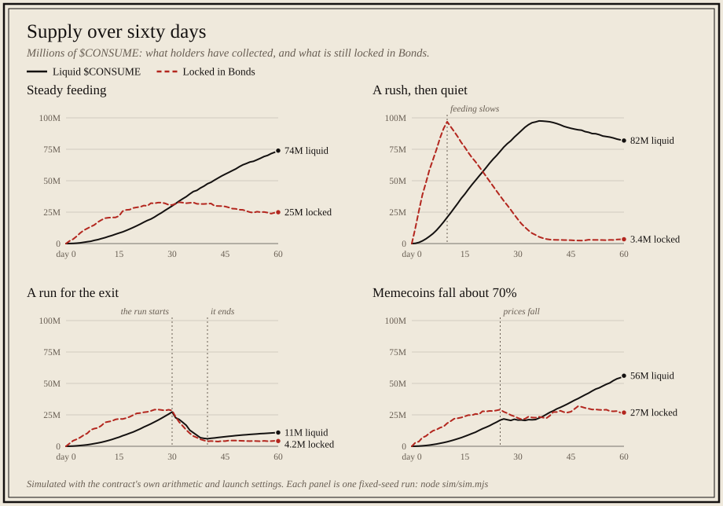
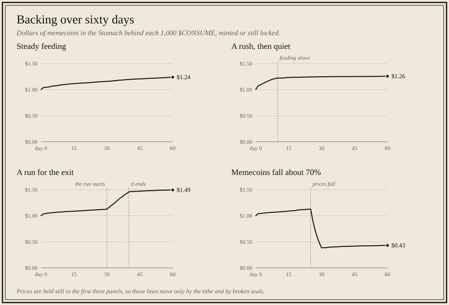

# Sixty days of CONSUME, simulated

The track asks: simulate 60 days of community behaviour first, and show supply over time under a few scenarios. This folder does that with the contract's own arithmetic.

```sh
node sim/sim.mjs
```

No dependencies, Node.js 22 or newer, about a second. Every run gives the same numbers, because the randomness comes from fixed seeds. It writes:

- `sim/out/steady.csv`, `rush.csv`, `run.csv`, `crash.csv`: one row a day (fed, tithe, the Feast, supply, locked, forfeited, redeemed, Stomach, backing)
- `sim/out/summary.md`: the table below
- `sim/charts/supply.svg` and `sim/charts/backing.svg`: the two charts below

## What is modelled

`model.mjs` is a port of the contract in whole numbers (BigInt), with the same rounding: `math.rs` line for line, and the rules of `meal.rs` (caps, the tithe and its steps, the Feast, minting at the backing), `vest.rs` (collect, break the seal) and `redeem.rs`. It uses the parameters the live contract was launched with and the ten memecoins with their real caps and their prices on 2026-11-09.

Before the scenarios run, the model is checked against known answers: the starting rate, the tithe schedule, a feeding that crosses a tithe step, and the README's example ($100 fed into a $100 Stomach at a 10% tithe is worth $94.74).

After every feeding, broken seal and redemption, the run checks the promise the design rests on: **the backing of each $CONSUME did not fall.** If it ever did, the run would stop with an error. It passed every time, between 1,796 and 2,882 checks a scenario.

## The four scenarios

Feedings arrive at random through the day (a Poisson count), sized around $60 with a long tail (lognormal). 30% of feeders pick the memecoin that is feasting, because it pays no tithe; the rest pick in proportion to the daily caps. In calm times a Bond has a 0.4% chance a day of having its seal broken, and a holder a 2% chance a day of redeeming half of what they hold.

| Scenario | What changes |
| --- | --- |
| Steady feeding | About 25 feedings a day for 60 days |
| A rush, then quiet | About 150 feedings a day for 10 days, then 3 a day |
| A run for the exit | Steady for 30 days. Then for 10 days, 12% of Bonds a day have their seal broken, a quarter of holders a day redeem everything, and feeding nearly stops |
| Memecoins fall about 70% | Steady for 25 days. Then every price falls over five days to between 10% and 40% of where it was and stays there, with more broken seals and redemptions for ten days |

## Supply over time



Supply only grows by feeding, and only as fast as Bonds release it. A run for the exit shrinks it: in that scenario 43M $CONSUME is burned and 8.6M is forfeited and never minted.

## Backing over time



Measured in dollars, the backing rises with every tithe and every broken seal, and falls only when the memecoins themselves fall. The run for the exit leaves the people who stayed with the highest backing of the four ($1.49 for 1,000 $CONSUME, from $1.00). The crash takes it to $0.43: the backing is a share of ten memecoins, not a price in dollars.

## The numbers

|  | Steady feeding | A rush, then quiet | A run for the exit | Memecoins fall about 70% |
| --- | ---: | ---: | ---: | ---: |
| Fed into the Stomach | $146,217 | $158,378 | $77,195 | $88,625 |
| Feedings | 1,505 | 1,636 | 877 | 919 |
| Feedings refused by a cap | 0 | 32 | 0 | 0 |
| Tithe paid to holders | $5,986 | $9,505 | $1,957 | $2,990 |
| Tithe not charged (Feast) | $4,136 | $1,833 | $1,419 | $1,386 |
| Seals broken | 141 | 164 | 477 | 200 |
| $CONSUME forfeited, never minted | 3.4M | 3.2M | 8.6M | 5.9M |
| $CONSUME burned by redeeming | 20M | 41M | 43M | 31M |
| Memecoins paid out | $23,773 | $51,142 | $54,624 | $15,894 |
| Liquid $CONSUME on day 60 | 74M | 82M | 11M | 56M |
| Locked in Bonds on day 60 | 25M | 3.4M | 4.2M | 27M |
| Stomach on day 60 | $122,444 | $107,236 | $22,572 | $35,717 |
| Backing of 1,000 $CONSUME, day 60 (starts at $1.00) | $1.238 | $1.256 | $1.494 | $0.431 |
| Largest memecoin in the Stomach | DOGE, 41% | DOGE, 24% | PENGU, 44% | DOGE, 35% |
| The Feast, week by week | none 1, DOGE 8 | none 1, DOGE 4, PENGU 1, SPX 2, SHIB 1 | none 1, PENGU 8 | none 1, DOGE 8 |
| Backing checks passed | 2,212 | 2,882 | 2,446 | 1,796 |

## What it found

1. **The backing never fell from an action.** No feeding, broken seal or redemption lowered it in any scenario. Only falling memecoin prices did.
2. **A run does not break it.** With a quarter of holders redeeming everything each day for ten days, everyone was paid their share in memecoins ($54,624 over the 60 days) and those who stayed ended with more behind each $CONSUME, not less.
3. **The Feast tends to stick.** With 30% of feeders chasing the memecoin that pays no tithe, the reigning Feast kept its crown in every later week in three scenarios out of four (DOGE, PENGU, DOGE). It changed hands only when feeding was thin. This is the mechanic's weak point as a game: the crown is easier to keep than to take.
4. **What the crown costs holders is bounded.** In steady feeding $4,136 of tithe was not charged, against $5,986 that was. A feeding with no tithe still mints exactly at the backing, so it takes nothing from holders; they only miss the tithe they would have been paid. And it is held to that memecoin's daily cap ($5,000 a day for the largest five), which is per memecoin, not per account, so many accounts gain no more room than one.
5. **The basket concentrates.** The largest memecoin ended at 24% to 44% of the Stomach. A redemption is paid in that mix.
6. **The caps only bit in the rush.** 32 feedings were refused in the scenario with 150 a day. In the others none were.

## What is left out

- Storage fees, failed payouts, and feedings refused for an old price. The Assayer is assumed honest and on time.
- Prices move only in the fourth scenario, and there all in one direction.
- Any market for $CONSUME or for Bonds. Nobody here trades; they feed, collect, break the seal or redeem.
- People who time the Feast on purpose. The 30% who chase it follow the crown; nobody tries to take it at the last hour. `agents/bots.mjs kingmaker` is that strategy, for anyone who wants to play it.
- The behaviour is assumed, not measured. The rates above are our guesses at a small community. Change them at the top of `sim.mjs` and run it again.
